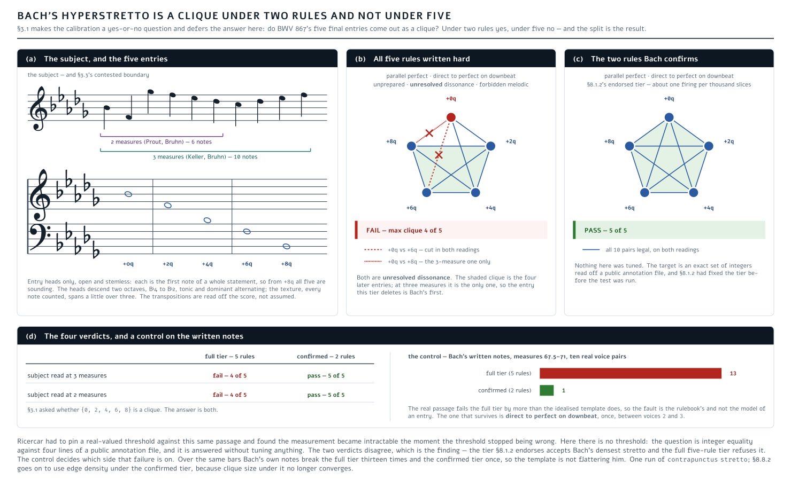
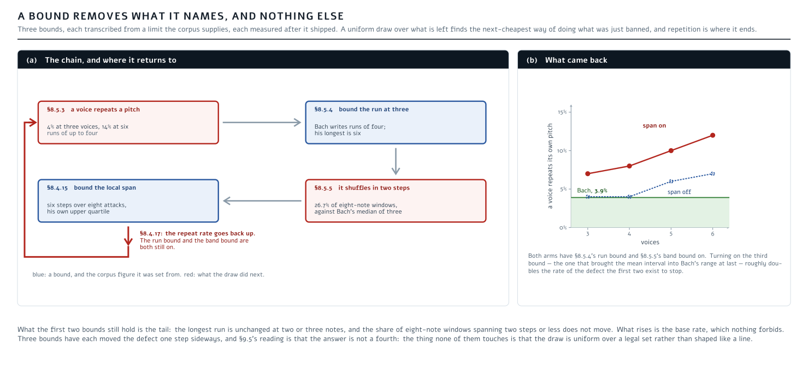

# Contrapunctus: Counterpoint is a regular language

### Fugue on the lattice: 73 states, a clique, and what Bach says about the rulebook

*Design document and current state. Automaton, stretto measure, harmonic analyser, realiser and form grammar are
built and measured; a generator writes whole fugues from a subject alone —
[§8](#8-what-is-built-and-what-it-measures). What remains open is [§9](#9-roadmap). How this was reached, and what did not survive, is in
[`CHANGELOG.md`](CHANGELOG.md).*

```math
\begin{aligned}
  \underbrace{
    \mathrm{fugue}\big(
      \underbrace{D}_{\text{material}},\;
      \underbrace{\Lambda}_{\text{plan}},\;
      \underbrace{\tau}_{\text{rulebook}},\;
      \underbrace{s}_{\text{seed}}
    \big)
  }_{\text{sentence}}
  \;&=\;
  \underbrace{B}_{
    \substack{
      \mathrm{derive}(D,\Lambda)\\
      \text{"symbols"}
    }
  }
  \;\times\;
  \underbrace{V}_{
    \underbrace{
      \begin{pmatrix}
        n_{1,1} & \cdots & n_{1,k_1}\\
        \vdots  &        & \vdots\\
        n_{m,1} & \cdots & n_{m,k_m}
      \end{pmatrix}
    }_{\text{notes per voice}}
  }
  \;\times\;
  \underbrace{\mathrm{parse}(B)}_{
    \substack{
      \text{is sentence}\\
      \text{grammatically}\\
      \text{correct?}
    }
  }\;\times\;
  \underbrace{\mathrm{check}_{\tau_2}(V)}_{\text{rulebook violations}}
\end{aligned}
```

---

## Contents

- [Abstract](#abstract)
- [The name is the argument in miniature](#the-name-is-the-argument-in-miniature)
- [Formalization](#formalization)
- [0. Where this comes from](#0-where-this-comes-from)
- [1. Diagnosis: ricercar's §8 is two causes, not seven items](#1-diagnosis-ricercars-8-is-two-causes-not-seven-items)
  - [1.1 The state is a point, not a transition](#11-the-state-is-a-point-not-a-transition)
  - [1.2 Ricercar's own evidence against the continuum](#12-ricercars-own-evidence-against-the-continuum)
- [2. The reformulation](#2-the-reformulation)
  - [2.1 Exact arithmetic, and therefore no certificates](#21-exact-arithmetic-and-therefore-no-certificates)
  - [2.2 Counterpoint is a finite automaton](#22-counterpoint-is-a-finite-automaton)
  - [2.3 Harmony is a second automaton](#23-harmony-is-a-second-automaton)
  - [2.4 Form is a grammar](#24-form-is-a-grammar)
  - [2.5 The search is a shortest path](#25-the-search-is-a-shortest-path)
  - [2.6 What is *not* a variable: rhythm](#26-what-is-not-a-variable-rhythm)
  - [2.7 Where a solver takes over from the DP](#27-where-a-solver-takes-over-from-the-dp)
- [3. Stretto, capacity, and the subject](#3-stretto-capacity-and-the-subject)
  - [3.1 The calibration disappears](#31-the-calibration-disappears)
  - [3.2 Capacity is a density, and it cannot be optimised](#32-capacity-is-a-density-and-it-cannot-be-optimised)
  - [3.3 The subject is input, and its boundary is contested](#33-the-subject-is-input-and-its-boundary-is-contested)
- [4. Space filling, in the right category](#4-space-filling-in-the-right-category)
- [5. What this will not do](#5-what-this-will-not-do)
- [6. What ricercar still owns](#6-what-ricercar-still-owns)
- [7. Prior art](#7-prior-art)
  - [7.1 Parallels within the same algorithmic family](#71-parallels-within-the-same-algorithmic-family)
- [8. [REDACTED]](#8-what-is-built-and-what-it-measures)
- [9. Roadmap](#9-roadmap)
  - [9.1 Two smaller shapes, waiting on the same thing](#91-two-smaller-shapes-waiting-on-the-same-thing)
  - [9.2 Open problems, in rough order of how much they block](#92-open-problems-in-rough-order-of-how-much-they-block)
  - [9.3 A possible experiment: giving the criterion something to say about harmony](#93-a-possible-experiment-giving-the-criterion-something-to-say-about-harmony)
  - [9.4 Loudness: a table from 1752, and the instrument question underneath it](#94-loudness-a-table-from-1752-and-the-instrument-question-underneath-it)
- [10. Reproducing the results](#10-reproducing-the-results)
  - [10.1 Environment and data](#101-environment-and-data)
  - [10.2 Which command produces which section](#102-which-command-produces-which-section)
  - [10.3 Parameters](#103-parameters)
  - [10.4 How the samples were taken](#104-how-the-samples-were-taken)
  - [10.5 What is not reproducible from this repository](#105-what-is-not-reproducible-from-this-repository)
  - [10.6 Using it as a library](#106-using-it-as-a-library)
---

## Abstract

Machine composition of fugue is usually attempted in one of two categories: fitting a model to a corpus, or
searching a continuous relaxation of the score. This document argues that both are the wrong category. Fugue is a
**word problem over a finite alphabet under constraints of bounded memory**, so the natural instruments are
automata, dynamic programming and exact combinatorial search, none of which require training data and all of which
return proofs instead of samples.

The argument opens as a post-mortem. [`ricercar`](ricercar/readme.md) modelled counterpoint as a
Lipschitz-certifiable roughness field over a continuum of entry placements, and its own measurements refute it. The
legal region proved **piecewise constant at the note grid**, and rounding a certified placement onto the semitone
grid costs about ten times the margin the certificate establishes, so the proof was taken over the wrong set.
Everything expensive in that approach existed to bound a function whose answer is constant on a lattice.

On the lattice the reformulation is small and largely classical. Counterpoint is a **finite automaton** over
`(interval, motion, articulation, metric weight)` whose state is the interval together with its outstanding
obligations: a dissonance owes a resolution, a leap owes a recovery. It remains finite because strict counterpoint
requires every debt settled on the next event. Harmony is a second automaton, form a grammar of five productions, and
realising free voices against fixed entries a shortest path, escalating to a CDCL solver where layering is known to
fail. Densest stretto becomes **maximum clique in a Cayley graph** on the shift group, exactly computable, where
the continuous formulation of the same question was abandoned at thirty minutes without a single placement. Bach's
five-voice hyperstretto in BWV 867 is such a clique, and its offsets form the arithmetic progression
`{0, 2, 4, 6, 8}` quarters. The object is a clique in a Cayley graph, emphatically not a Sidon set.

The counterpoint automaton, the stretto measure, a harmonic analyser, the realiser and the form grammar are built
and measured against the 24 fugues of the Well-Tempered Clavier, Book I, and against 200 works of 15th-century
polyphony, using published ground-truth annotations and Huron's Humdrum encodings. The automaton has **73 reachable
states**, and distinguishes a prepared suspension from the same interval struck on the same beat. A field over
instantaneous pitch is structurally unable to draw that distinction, which is the device most of the repertoire
worth imitating is built from. Run as a checker over two corpora, the automaton **stratifies its own rulebook into
three tiers**. Parallel perfect consonances and direct motion to a perfect consonance on a downbeat hold in both
centuries at about one violation per thousand slices. The melodic prohibition holds in Renaissance vocal writing
and fails in Bach by a factor of thirty-eight, making it repertoire-specific but not wrong. The two dissonance
rules fail in the very repertoire they were written for. The surviving pair is precisely the pair a roughness field
cannot express, since a perfect fifth is among the smoothest intervals it knows.

The clique test selects that same two-rule tier a second time by an independent route. **Under the full five-rule
tier Bach's hyperstretto is not a clique; under the two-rule tier it is**, on both contested readings of the
subject, and a control run on the written notes instead of on idealised transpositions locates the fault in the
rulebook and not in the model of an entry. Two independent tests converge on the same two rules: one counts rule
frequencies across two centuries, the other asks whether a single passage is mutually compatible. Neither was
designed to check the other, which makes the agreement the strongest result reported here.

Capacity, measured as the **edge density of the compatibility graph**, ranks **BWV 849 first of 24**, the fugue
musicians name when they name a stretto fugue, and correlates only −0.32 with note density, so it is no proxy for
how busy a subject already is. It ranks and **cannot design**: optimising a contour against it yields a monotone,
and Bach's own contours score below random on their own rhythms. The cause is structural. Both surviving rules
require a perfect consonance to fire and a fugal answer lies at the fifth, so the measure penalises the interval
the form is built on. A design objective must therefore be harmonic, and that remains open.

The realiser then produces notes, and with them the method's characteristic difficulty, which inverts the usual
one: **a complete search fails not by finding nothing but by finding far too much.** Holding one of Bach's subject
entries fixed, taking his rhythm and a harmonic plan derived only from voices the search cannot see, and filling
the remainder exactly, the rulebook leaves seven to seventeen pitches open at every note and between `10¹²` and
`10¹⁹` complete legal fills of a three-bar span. Across every combination of rulebook and plan, **agreement with
what Bach wrote barely moves while the chance baseline nearly triples**: the constraints do all of the work and the
objective almost none. Two controls establish this. Reversing the sign of the objective scores 5.1% against
minimising's 7.9%, so the soft criteria are not noise and point the right way. Drawing from the legal set
**uniformly** instead of optimising over it at all — which the search performs exactly, having already counted the
paths through its own DAG — scores 6.7% and 7.0% on two seeds, and paired per span that difference is not
significant; on a sample five times larger the uniform draw is ahead on both corpora, on both seeds. **Using the soft tier is therefore no better than ignoring
it**, and drawing is the endorsed mechanism. Where taste enters was the central problem and not an afterthought.
This document refuses a weighted sum over the soft criteria, on the ground that no weighting in the literature is
defensible and Fux supplies none. It set out to take the **Pareto front** instead ([§5](#5-what-this-will-not-do)),
and built it only after finding that it never had ([§8.10.3](#8103-the-pareto-front-was-never-built-and-the-central-negative-result-never-met-it), [§8.10.5](#8105-the-front-built-and-refused-it-stratifies-like-the-weighting-it-replaces)): drawn from, the front
gains Bach three quarters of a point and costs the fifteenth century more than two, which is what a treatise
weighting does, and it is refused. What ships is the uniform draw, and [§8.4.18](#8418-the-criterion-reaches-when-it-is-allowed-to-move-the-bound)
finds a criterion reaching only when it is allowed to move a bound rather than choose inside a fixed legal set.

Two further results fall out of building it. The melodic prohibition is **repertoire-specific as a description and
load-bearing as a constraint**: the corpus stratified it out of the hard tier for flagging Bach thirty-eight times
more often than the Renaissance, yet without it nothing bounds a free voice's line at all, and restoring it halves
the pitches left open at every note. The exact search meets its wall at **two** free voices instead of the
predicted four, because the multiplier is the compounding obligation state and not the product of pitch domains.
That is an argument for conflict-learning search both stronger and earlier than the one this document set out
with.

**Method.** Nothing here is fitted to a corpus. The rules are transcribed from treatises; every threshold is either
measured against an exhibited passage or swept and reported as a curve. The bounds the generator ships — on a
voice's run, its band and its local span — are read off the corpus at a stated percentile; the harmonic
analyser's change penalty, the one parameter that had to be chosen outright, is held out on half the corpus and
cross-checked on the other; and the engineering constants, a layer's width and a sample count among them, are
listed in [§10.3](#103-parameters) with the measurement each was set from. How this position was reached, including the four
claims it replaced, is in [`CHANGELOG.md`](CHANGELOG.md).

---

## The name is the argument in miniature

*Ricercare*, to search: that document named its method. *Contrapunctus* — **punctus contra punctum**, point against
point — names its objects. Note against note. The material is discrete, countable, and set against itself, and the
word says so in the first syllable. It is also Bach's own heading for each movement of the *Art of Fugue*, which is
the one place in the repertoire where the combinatorial content and the aesthetic content very nearly coincide.

---

## Formalization

The whole program in one pass, from the rulebook to a finished piece. Everything below is exact arithmetic over
finite sets; nothing is fitted, sampled from a corpus, or approximated.

#### The ground

A pitch is a **diatonic step with an alteration**, never a semitone integer, so that a diminished fifth and an
augmented fourth are different objects:

```math
\mathcal{P}=\mathbb{Z}\times\mathbb{Z},\qquad p=(\mathrm{step},\mathrm{alter})
```

Interval quality is then a total function $\iota:\mathcal{P}^2\to\mathcal{I}$ with no lookup and no rounding.
Time is $\mathcal{T}=\mathbb{Z}$ in ticks of one 960th of a whole note — the smallest base making every duration in
both corpora exact. A note carries an attack bit, so a struck dissonance and a tied one are distinguishable:

```math
\mathcal{N}=\mathcal{T}\times\mathcal{T}\times\mathcal{P}\times\mathbb{B},\qquad
\mathcal{V}=\mathcal{N}^{*},\qquad n=(\mathrm{onset},\mathrm{dur},p,\mathrm{attack})
```

Voices $V=(v_1,\dots,v_m)$ are sliced at the ticks where anything articulates. **$V$ is the voices and $m$ is how many there are**, throughout:

```math
\Theta(V)=\mathrm{sort}\,\lbrace \,\mathrm{onset}(n)\ :\ n\in v_i,\ i\le m\,\rbrace ,\qquad
\ell_k=[\theta_k,\theta_{k+1})
```

#### The pair automaton

Counterpoint is judged pairwise. A slice presents each pair with a letter:

```math
\Sigma=\underbrace{\mathcal{W}}_{4}\times\underbrace{\mathcal{M}^{2}}_{25}\times
\underbrace{\mathbb{B}^{2}}_{\text{tied}}\times\underbrace{\mathcal{B}}_{3}\times
\underbrace{\mathbb{B}}_{\text{altered}}\times\underbrace{\mathbb{B}}_{\text{crossed}},
\qquad |\Sigma|=4\cdot 25\cdot 4\cdot 3\cdot 2\cdot 2=4800
```

with $\mathcal{W}=\lbrace \text{P8},\text{P5},\text{imperfect},\text{dissonant}\rbrace$,
$\mathcal{M}=\lbrace \text{hold},\text{step}\pm,\text{leap}\pm\rbrace$ and $\mathcal{B}=\lbrace \text{bar},\text{beat},\text{off}\rbrace$.
The metre is three-valued because two rules want the position at two different coarsenesses.

The state is **the interval plus what you owe**. Eight obligation bits — resolve a suspension in either voice,
recover a leap up or down in either voice, leave a passing note in either voice:

```math
Q=(\mathcal{W}\cup\lbrace \bot\rbrace )\times 2^{O},\qquad |O|=8,\qquad |Q|=5\cdot 256=1280
```

Only **73** of those are reachable, and once an obligation dies with the dissonance that incurred it the count is
derivable rather than merely enumerable:

```math
\underbrace{1}_{\text{start}}+\underbrace{3\cdot 9}_{\text{consonant}\times\text{leap debts}}+
\underbrace{5\cdot 9}_{\text{dissonance readings}\times\text{leap debts}}=73
```

Nine because each voice owes up, down, or nothing; five because a dissonance owes at most one of *suspension
resolves below*, *above*, *passing note leaves below*, *above*, or nothing. 45 of the 256 obligation sets occur.

The transition reports which rules fired and where the debts stand:

```math
\delta:Q\times\Sigma\to 2^{\mathcal{R}}\times Q,\qquad
\delta(q,\sigma)=\big(\mathrm{fired}(q,\sigma),\ q'\big)
```

Finiteness is not an approximation: strict counterpoint requires debts settled on the next event, so no state
carries history beyond one slice.

#### The rulebook, as tiers

```math
\mathcal{R}=\mathcal{R}_{\text{hard}}\ \sqcup\ \mathcal{R}_{\text{soft}},\qquad
|\mathcal{R}_{\text{hard}}|=5,\quad|\mathcal{R}_{\text{soft}}|=6
```

Running $\delta$ as a checker over two corpora stratifies the hard five into a chain of tiers:

```math
\tau_{2}\ \subset\ \tau_{3}\ \subset\ \tau_{5}
```

$\tau_2$ is parallel perfect consonances and direct motion to a perfect consonance on a downbeat — the two that
hold in both centuries; $\tau_3$ adds the melodic prohibition; $\tau_5$ adds the two dissonance rules. A transition
is **legal under $\tau$** iff the rules it fires miss $\tau$ entirely:

```math
\mathrm{legal}_\tau(q,\sigma)\iff \mathrm{fired}(q,\sigma)\cap\tau=\emptyset
```

The tier that *describes* the repertoire and the tier a generator should *write against* are not the same one:
$\tau_2$ is endorsed for description, $\tau_5$ for generation.

#### The harmonic automaton

A second obligation system runs on the same grid and shares no state with the first. A plan is a segmentation with
a chord and a goodness of fit per segment:

```math
\pi=\big((t_0,t_1,c_1,f_1),\dots\big),\qquad c_j\in\mathcal{C}\cup\lbrace \bot\rbrace 
```

A pitch foreign to the prevailing chord is legal only if prepared or approached by step, and owes a resolution on
the next articulation. Writing $H$ for its obligation set, the two systems compose without special-casing, which is
what makes the product state $Q^{\text{pairs}}\times H$ well defined at all.

#### A span as a layered DAG

A fill problem fixes everything except pitch in the free voices:

```math
\Pi=(V,\ F,\ C,\ \kappa,\ \mu,\ \pi,\ \tau,\ w,\ \mathrm{prior},\ \mathrm{join})
```

$F\subseteq\lbrace 1..m\rbrace$ are free; a free voice contributes its **rhythm only** and its pitches are discarded, so the
search cannot choose when a note happens. $C_i$ is voice $i$'s compass, $\mathrm{prior}$ the pitch each voice ended
on before the span, $\mathrm{join}$ the pitch the span must be able to reach at its far edge.

A node at layer $k$ is an assignment to the free voices together with the automaton state of every pair touching
one, and the harmonic obligation:

```math
N_k\ \subseteq\ \prod_{i\in F}C_i\ \times\ Q^{\lbrace (i,j)\,:\,i\in F\rbrace }\ \times\ H
```

and an edge exists exactly where every pair and the harmony admit it:

```math
x\to y\iff \bigwedge_{(i,j)}\mathrm{legal}_\tau\big(q_{ij}(x),\sigma_{ij}(x,y)\big)\ \wedge\ \mathrm{harm}(x,y)
```

The legal set of the span is the set of source-to-sink paths, and its size is a fold over the DAG rather than an
estimate:

```math
c(x)=\begin{cases}1 & x\in N_L\\ \sum_{x\to y}c(y) & \text{otherwise}\end{cases}
\qquad |L(\Pi)|=\sum_{x\in N_0}c(x)
```

**The cost is the obligation set, not the pitch product.** Two free voices give a few hundred pitch pairs and tens
of thousands of live states, because a dissonance owed in one pair and a leap owed in another are independent bits
compounding across every pair at once. A layer exceeding the budget is **refused**, never truncated:

```math
\max_k |N_k| > 60\,000\ \Longrightarrow\ \Pi\ \text{refused}
```

#### Choosing a path

Two selections over the same $L(\Pi)$, and they are different objects:

```math
\text{minimise}:\quad \arg\min_{P\in L(\Pi)}\ \sum_{r\in\mathcal{R}_{\text{soft}}} w_r\cdot\#_r(P)
\qquad\qquad
\text{draw}:\quad \Pr[P]=\frac{1}{|L(\Pi)|}
```

The draw is realised exactly by walking the DAG backwards with $\Pr[y\mid x]=c(y)/c(x)$. **The draw is the endorsed
mechanism**, and it must be asked for rather than reached by setting $w=0$: to a shortest path a zero objective
means every path ties and the first found wins, which is a degenerate line and not a sample.

#### The form grammar and the derivation

```math
\begin{aligned}
\mathrm{Fugue}&\to\mathrm{Exposition}\ \mathrm{Middle}^{+}\ \mathrm{Final}\\
\mathrm{Exposition}&\to\mathrm{Entry}\ \big(\mathrm{Link}?\ \mathrm{Countersubject}\ \mathrm{Entry}\big)^{m-1}\ \mathrm{Redundant}?\\
\mathrm{Middle}&\to\mathrm{Episode}\ \mathrm{Entry}^{+}\\
\mathrm{Final}&\to\mathrm{Stretto}?\ \mathrm{Pedal}?\ \mathrm{Cadence}
\end{aligned}
```

A design is the material and a layout is what is done with it:

```math
D=(\mathrm{subject},m,\kappa,\mathrm{tonic},\mathrm{measure},\mathrm{beat},C),\qquad
\Lambda=(\mathrm{middles},\mathrm{episode\ bars},\mathrm{link},\dots)
```

`derive` turns the pair into blocks laid strictly end to end, so a gap and an overlap are not expressible:

```math
\mathrm{derive}(D,\Lambda)=B=(b_1,\dots,b_n),\qquad
b_i=(\mathrm{at}_i,\mathrm{len}_i,\mathrm{kind}_i,\mathrm{key}_i,\mathrm{also}_i),\qquad
\mathrm{at}_{i+1}=\mathrm{at}_i+\mathrm{len}_i
```

The lane advances by one each block, which is why a block's voice is not independently settable and a *rotation* is
what a caller may ask for instead:

```math
\mathrm{lane}(b_{i+1})=\big(\mathrm{lane}(b_i)+1+{\sum}_{j\le i+1}t_j\big)\bmod m
```

A block may place more than one line — `also` is what makes a stretto and an augmented ground expressible:

```math
\mathrm{placed}(b)=\lbrace (\mathrm{lane}(b),\,\mathrm{at}(b))\rbrace \cup
\lbrace (x.\mathrm{voice},\,\mathrm{at}(b)+x.\mathrm{at})\ :\ x\in\mathrm{also}(b)\rbrace ,\qquad
\mathrm{held}(b)=\lbrace v\ :\ (v,t)\in\mathrm{placed}(b)\rbrace 
```

Each placed line is the subject transposed by its shift — by Marpurg's rule where it is the *comes* — scaled by its
device $\in\lbrace 1,2,\tfrac12\rbrace$, and folded into the taking voice's compass by whole octaves.

#### The block fill, and the relaxation ladder

Block $i$ becomes a problem: placed lines fixed, resting voices absent, everything else free on the subject's own
note values tiled and rotated by a distinct phase per voice.

```math
F_i=\lbrace 1..m\rbrace \setminus\big(\mathrm{held}(b_i)\cup\mathrm{rest}(b_i)\big)
```

`prior` carries the last pitch of **every** voice across the seam, not only the free ones, because a parallel is a
fact about two voices moving together. What still resets at a block edge is the obligation state.

The ladder drops the generator's own convenience before it drops §2.3's obligation system, because the plan is
also what keeps the search tractable:

```math
\mathrm{fill}^{\star}(\Pi)=\mathrm{fill}\big(\Pi\setminus R_{k}\big),
\qquad k=\min\lbrace j\ :\ \mathrm{fill}(\Pi\setminus R_{j})\ \text{succeeds}\rbrace
```

where $\emptyset=R_0\subsetneq R_1\subsetneq\cdots\subsetneq R_7$ is a fixed chain, each rung dropping everything
the rung above it dropped and one thing more:

| rung | what $R_j$ drops | reported as |
|---:|---|---|
| 0 | nothing | — |
| 1 | the local span loosens to the corpus's seven steps | `without_reach` |
| 2 | the local span goes | `without_reach` |
| 3 | the band loosens to the book's longest | `without_band` |
| 4 | the band and the run bound both go | `without_run` |
| 5 | the plan loosens from the chords the block's key names to every chord ([§8.4.23](#8423-the-harmony-the-grammar-decides-clears-the-rule-and-keeps-the-free-voices-in-the-key)) | `loose_plan` |
| 6 | the join to the previous block | `without_prior`, `cold` |
| 7 | the harmonic plan, the seam ahead, and invertibility | `without_plan` |

Rungs 1 and 2 exist only when `Layout::span` is set, which since
[§8.4.17](#8417-the-default-flipped-and-what-moved) is the default. Without it the chain is
$R_0\subsetneq\cdots\subsetneq R_5$ with rungs 3–7 renumbered down by two. The table's rung 5 is §8.4.23's;
without it and without the span's two, the chain is the ladder
[§8.5.5](#855-the-bound-moved-the-defect-one-step-sideways) measured and the one every figure published before
[§8.4.15](#8415-a-compass-is-a-range-and-the-search-had-been-reading-it-as-freedom) was written against.
`compose::relaxed_of` carries the difference as a single `shift`, so the named relaxations keep
naming their own constraint under either configuration.

Two properties of the order are deliberate. It drops the generator's own convenience before §2.3's
obligation system, because the plan is also what keeps the search tractable. And the two bounds that have a
corpus-supplied looser setting **take it before they are dropped**, which is
[§8.5.5](#855-the-bound-moved-the-defect-one-step-sideways)'s repair of its own mistake: one rung shared
between two constraints let the easier one go with the harder, and wrote back exactly what the easier one
existed to stop.

Which rung each block landed on is reported per block, and the interface panel names all five relaxations.

#### The whole generator

The seed is keyed on **what a block is**, never on where it sits, so editing one block does not reseed the others:

```math
\mathrm{ident}(b)=h(\mathrm{kind},\mathrm{lane},\mathrm{key},\mathrm{len}),\qquad
s_i=g\big(s,\ \mathrm{ident}(b_i),\ \rho(\mathrm{ident}(b_i))\big)
```

with $\rho$ the reroll count. One fold over the blocks writes the piece:

```math
V^{(0)}=\emptyset,\qquad
V^{(i)}=V^{(i-1)}\ \cup\ \mathrm{fill}^{\star}\big(\Pi_i(B,\,V^{(i-1)})\big),\qquad
V=V^{(n)}
```

There is exactly one such fold. `generate` enters it at block 0 and `refill_span` enters it at block $k$ with the
prefix already written, so an edit is the same function resumed:

```math
\mathrm{refill}(B,V,k)=\mathrm{Run}\ \text{from}\ k,\qquad V^{(n)}\big|_{t\,<\,\mathrm{at}_k}\ =\ V\big|_{t\,<\,\mathrm{at}_k}
```

Finally the piece is judged by every instrument the document has, including a checker that does not know it was the
generator:

```math
\mathrm{fugue}(D,\Lambda,\tau,s)=\big(B,\ V,\ \underbrace{\mathrm{parse}(B)}_{5\ \text{verdicts}},\ \underbrace{\mathrm{check}_{\tau_2}(V)}_{\text{rule firings}},\ \mathrm{Relaxed},\ \text{seconds}\big)
```

#### The devices, and which of them are built

A statement of the subject is its image under a pitch map and a time map, which act on independent components and
therefore compose freely:

```math
\Phi=\langle T_k,\ I_a\rangle,\qquad \Psi=\langle \Delta_t,\ A_r,\ R_L\rangle,\qquad
\sigma=(\varphi,\psi)\cdot S,\quad \varphi\in\Phi,\ \psi\in\Psi
```

```math
T_k:\ \mathrm{step}\mapsto\mathrm{step}+k,\qquad
I_a:\ \mathrm{step}\mapsto 2a-\mathrm{step},\qquad
\Delta_t:\ \mathrm{onset}\mapsto\mathrm{onset}+t
```

```math
A_r:\ (\mathrm{onset},\mathrm{dur})\mapsto(r\,\mathrm{onset},\ r\,\mathrm{dur}),\qquad
R_L:\ (\mathrm{onset},\mathrm{dur})\mapsto(L-\mathrm{onset}-\mathrm{dur},\ \mathrm{dur})
```

`alter` is re-derived from the key signature instead of carried along, so $T_k$ is **diatonic**: the interval
qualities change with the degree, which is why a transposed subject is not an interval-for-interval copy. The
tonal answer is not in $\Phi$ at all. It is a partial map $M$ agreeing with $T_4$ except on the degrees
[§8.6.2](#862-marpurgs-tonal-answer-one-rule-exact-one-wrong)'s Rule I mutates, and a
partial map has no inverse, so it generates nothing.

`Voiced` realises exactly

```math
(\varphi,\psi)=\big(I_a^{\,\epsilon}(T_k\ \text{or}\ M),\ \ R_L^{\,\rho}A_r\Delta_t\big),\qquad \epsilon,\rho\in\lbrace 0,1\rbrace,\quad r\in\lbrace 1,2,\tfrac12\rbrace
```

so every ratio outside those three is the unbuilt part of the single-line devices. $I_a$ is
[§8.4.24](#8424-two-fugues-written-for-a-listener-and-the-seven-things-they-were-missing)'s, and $R_L$ and every product of the three maps
[§8.8.9](#889-three-maps-and-a-rulebook-that-is-not-the-same-backwards)'s.

Devices that relate *lines* rather than transform one are three more objects:

```math
\text{stretto}:\ \lbrace\sigma_1,\dots,\sigma_n\rbrace\ \text{with}\ \exists\,i\ne j:\
\mathrm{supp}\,\sigma_i\cap\mathrm{supp}\,\sigma_j\ne\emptyset
```

```math
V_N:\ \iota(u,l)\mapsto N-\iota(u,l)
\qquad N=9\ \text{at the octave},\quad 11\ \text{at the tenth},\quad 13\ \text{at the twelfth}
```

```math
\mathrm{ped}_v(t_0,t_1):\ p_v\ \text{constant on}\ [t_0,t_1),\ \text{with every pair it forms exempt from}\ \delta
```

$V_N$ is why `Countersubject::Invertible` exists: at $N=9$ the fifth maps to $N-5=4$, a fourth, so Marpurg has the
fifth handled as a dissonance. The same arithmetic at $N=11$ and $N=13$ exempts it again and forbids other
intervals instead, which is a change to the rulebook and not to the derivation.

| device | notation | built |
|---|---|---|
| entry, *dux* | $(T_0,\Delta_t)$ | ✔ |
| real answer | $(T_4,\Delta_t)$ | ✔ |
| tonal answer, *comes* | $(M,\Delta_t)$ | ✔ §8.6.2 |
| octave displacement | $T_{7j}$ | ✔ `compose::placed` |
| augmentation | $A_2$ | ✔ §8.8.4 |
| diminution | $A_{1/2}$ | ✔ §8.8.4 |
| double augmentation, double diminution | $A_4$, $A_{1/4}$ | — |
| inversion, *al rovescio* | $I_a$ | ✔ §8.4.24 |
| augmented or diminished inversion | $I_a A_2$, $I_a A_{1/2}$ | ✔ §8.8.9 |
| retrograde, *cancrizans* | $R_L$ | ✔ §8.8.9 |
| retrograde inversion | $I_a R_L$ | ✔ §8.8.9 |
| stretto | overlapping $\mathrm{supp}\,\sigma_i$ | ✔ §8.8.4 |
| countersubject | a second line recurring with every $\sigma$ | ✔ §8.7.4 |
| invertible counterpoint at the octave | $V_9$ | ✔ §8.7.4 |
| at the tenth, at the twelfth | $V_{11}$, $V_{13}$ | — |
| triple, quadruple counterpoint | $V_N$ over three or four lines | — |
| pedal point | $\mathrm{ped}_v$ | — in the grammar only; §8.4.24's close holds the tonic without the exemption |
| episode as sequence | $\mathrm{Seq}(m,n,k)$, motive $m$ down $k$ steps $n$ times | ✔ |
| link, codetta | an episode inside the exposition | ✔ |
| false entry | $\sigma$ truncated to a proper prefix of $S$ | — |
| redundant entry | an extra $\sigma$ after the exposition's $m$ | — named, unchecked |
| counter-exposition | a second exposition, voices permuted | — |
| double, triple fugue | $S_1,S_2(,S_3)$ each with its own $\Phi\times\Psi$ | — [§9](#9-roadmap) |
| mirror fugue | $I_a$ applied to the **whole texture** | — |
| permutation fugue | every voice takes every line, in rotation | — |

**What the unbuilt ones would cost is not uniform, and the table hides that.** $R_L$ is one more `Device`
variant, changing the map `stated` applies, since the grammar schedules statements without knowing what a
statement is — or it was, until [§8.8.9](#889-three-maps-and-a-rulebook-that-is-not-the-same-backwards) built it as three maps instead, because a variant
per map multiplies and an inversion could not be augmented while the device was one value. $I_a$ was one, in [§8.4.24](#8424-two-fugues-written-for-a-listener-and-the-seven-things-they-were-missing), and it touched more than the map: the countersubject beside it
has to be mirrored about the entry's axis, and a stretto of it needs a placement search of its own. $V_{11}$ and
$V_{13}$ are a rulebook change, one line in the
interval classification. A pedal needs an exemption from $\delta$, which is the first thing in this document that
would ask the automaton to *not* judge something. A double fugue needs a second subject in `Design` and a grammar
that interleaves two expositions. A mirror fugue needs the texture generated once and reflected, which no part of
[§2.5](#25-the-search-is-a-shortest-path)'s search is arranged to do.

#### Stretto, as a clique

Densest stretto is not a search over the score but a question about the subject alone. Take the shift group, put a
vertex at every placement and an edge where the pair is legal:

```math
G_\tau=(\mathcal{S},E),\qquad
\lbrace u,v\rbrace \in E\iff \text{the two statements admit a legal fill under }\tau
```

Then the densest stretto is a **maximum clique** in a Cayley graph on that group, exactly computable, and capacity
— which ranks subjects and cannot design one — is its edge density:

```math
\mathrm{cap}(\text{subject})=\frac{2|E|}{|\mathcal{S}|\,(|\mathcal{S}|-1)}
```

A clique over transpositions is an upper bound on what can be *sung*: assigning the lines to voices folds them by
octaves, and an octave displacement turns a fourth into a fifth, so the arrangement is re-checked after the fold
and only what survives is kept.

---

## 0. Where this comes from

### What the literature said could not be done

Rule-based composition is sixty years old and the thing it has never reached is **form**. The two sources this
project leans on hardest say so in their own words. Schottstaedt, whose 1984 report is the closest prior attempt at
the scale attempted here, ends his account of the search with:

> *"However, this entire program ignores issues of phrasing or larger melodic and rhythmic structures. If we decide
> to carry this effort further in that direction, a much more complex decision and search mechanism will be
> required."*

And Anders & Miranda's survey of the whole field, twenty-seven years later, closes on the same absence:

> *"Other neglected fields include harmonic counterpoint, and the modeling of melody and musical form."* … *"no
> system supports that the hierarchic structure of the score can be constrained freely, but such a feature would be
> highly useful for modeling musical form."*

**Both are answered here, and the second is answered by construction.** Form is [§2.4](#24-form-is-a-grammar)'s grammar —
five productions over entries, episodes and cadences — and the hierarchic structure of the score *is* the thing
constrained, because the plan is derived from the grammar before a note is filled.
[§8.7.2](#872-does-the-form-grammar-derive-the-book) then does the thing a claim like this is usually not made to survive: it parses the
Well-Tempered Clavier with those productions and reports **13.6%** — the share of the repertoire the grammar was
written from that it actually derives. Which is to say the grammar is mostly wrong about Bach, and that figure is
published rather than buried.

> **One caveat, in the project's own manner.** A stronger formulation of the impossibility claim — that achieving
> form is impossible by *any* such algorithm — is often attributed to this literature and is **not** in any source
> [§7](#7-prior-art) holds. The two quotations above are what those authors actually wrote: form is *unaddressed*
> and would need a much more complex mechanism, not *unreachable*. This document does not need the stronger version
> and will not borrow it.

### It writes a stricter exposition than Bach does

[§8.7.6](#876-the-generator-against-the-book) generates a fugue from each of Bach's own twenty-four subjects and parses both with the
same grammar. On the whole derivation the generator scores **23 of 24** where the book scores **13.6%**, and the
clause that separates them is the exposition running unbroken: **100%** against Bach's **18.2%**.

That is a real result and it is not a compliment. §8.7.2 measured a link inside the exposition in **82%** of the
book — §2.4's production forbids one, and `Layout::link` writes it precisely because Bach does. The generator holds
the grammar more consistently than Bach because Bach is under no obligation to it and this is. **Where the two
differ, the book is the authority and the grammar is the thing being corrected**; what the figure shows is that the
form is *reached*, deliberately and repeatably, which is what the literature above says had not been done.

> **Re-measured in [§8.10.6](#8106-a-hundred-and-twenty-of-the-books-entries-were-never-read)**: read whole — the 120 entries that begin after a rest included — the book derives at
> **25.0%**, not 13.6%, holds the unbroken exposition a third of the time, not 18.2%, and has a link in two thirds
> of its expositions, not 82%. The comparison stands in its direction and narrows.

The counterpoint, meanwhile, is the book's equal on the book's own measure: **0.9** rule firings per thousand
judged pair-slices as it ships and **1.1** with the link taken out, against Bach's median of **0.8** and a range
that runs to 64, by the same checker that measured him.

### And then past him

Bach's densest keyboard fugue is the five-voice hyperstretto of BWV 867; *Die Kunst der Fuge* is in four.
[§8.2.5](#825-restrict-a-layer-instead-of-refusing-it) and [§8.2.6](#826-every-core-at-last) write **six**, legal on the tier the search enforces
and drawn from the legal set in thirteen blocks of fifteen, and [§8.8.8](#888-which-subject-carries-six-voices-and-it-is-not-the-one-everybody-would-name)
writes one from **every one of Bach's twenty-four subjects in under a minute** — a median of about ten seconds, a
slowest of fifty, re-timed for [§8.10.2](#8102-every-figure-re-measured-and-what-no-longer-holds) with nothing else running. The same generate was a
hundred and thirty-six seconds on one fixture subject at the start of the work those sections record.

[§8.9.6](#896-where-the-voice-count-stops-being-a-keyboard-piece) is what makes that worth saying rather than merely counting. It puts Parncutt's ergonomic
span table against the output and asks whether two hands could play it: **two hands cannot reach forty per cent of
that fugue's slices**, and it asks for a hand of **twenty-eight semitones** — two octaves and a fourth — where
Bach's entire book asks for seventeen. (Re-measured for [§8.10.2](#8102-every-figure-re-measured-and-what-no-longer-holds), the defaults that ship now refuse that
six-voice design outright; lift either of the two bounds that refuse it and two hands cannot reach 43% to 50% of
its slices, at twenty-seven or twenty-eight semitones.) The failure is not gradual — `0.3%`, `2.8%`, `26%`, `40%`
as the voices go three, four, five, six, and `1.8%`, `3.2%`, `22%` and at least `43%` today — so somewhere between four voices and five the output stops being a keyboard piece and
becomes something only an ensemble or a machine can sound.

**That is the point of the exercise, not a side effect.** A rulebook transcribed by hand from treatises, applied by
an exact search that draws uniformly from what the rules permit, has no opinion about how many hands are available.
It composes at six voices for the same reason it composes at three, and the result is a piece that keeps every
rule the search was asked to enforce — which is not all five of Fux's and Marpurg's, as
[§8.10.1](#8101-the-whole-history-of-one-number-is-two-commits) counts — and could not have been written at a
keyboard by the people who wrote the rules.

---

### The immediate cause

Ricercar reached step 5 and stopped, blocked twice: once on principle (the threshold `θ` was unpinned, so a corpus
comparison would measure the threshold rather than the subject) and once on cost (the calibrated run was killed at
thirty minutes without a single placement). [§8](ricercar/readme.md#8-what-this-will-not-do) of that document lists seven things the method will not do.

The question this answers: *starting over, without space-filling, is there an approach free of most of [§8](ricercar/readme.md#8-what-this-will-not-do), and
elegant rather than fitted?*

Yes. The first evidence for it is in ricercar's own results.

---

## 1. Diagnosis: ricercar's §8 is two causes, not seven items

| [§8](ricercar/readme.md#8-what-this-will-not-do) item | cause |
|---|---|
| the stylistic rules — parallel fifths, voice crossing | **the state is a point, not a transition** |
| resolution, suspension | same |
| harmony, "the difference between a cadence and a stop" | **the surrogate is not the thing** — roughness is psychoacoustics, not tonality |
| form | neither; it was simply never modelled |
| the 2-approximation guarantee | an artefact of the geometric framing |
| whether the result is good | irreducible — see [§5](#5-what-this-will-not-do) |

### 1.1 The state is a point, not a transition

**A parallel fifth is not a property of an instant.** Neither is contrary motion, voice crossing, a suspension, a
cadence, or voice independence in any form. They are properties of *consecutive configurations*. A field over
instantaneous pitch content is not underpowered here — it is structurally incapable of expressing any of them, and
that single fact generates most of [§8](ricercar/readme.md#8-what-this-will-not-do). Ricercar says as much: *"a field over instantaneous pitch cannot express any
of them."*

The repair is cheap once the diagnosis is stated:

> **Every rule of strict counterpoint is a condition on at most three consecutive events.**

That is not an approximation of the rulebook. It is what the rulebook says, and [§2.2](#22-counterpoint-is-a-finite-automaton) takes it literally.

Panel (c) of the map at the head of [§2](#2-the-reformulation) draws the consequence rather than restating it: the
same seventh, reached two ways — legal where it is tied over and refused where it is leapt into. A
field over instantaneous pitch content has one object there. This has two.

### 1.2 Ricercar's own evidence against the continuum

Two measurements, neither of them arguments:

- **[§7.3](ricercar/readme.md#73-step-3-result-the-legal-region-and-what-its-shape-gives-away).** *"The legal placement region is piecewise constant in entry offset, at the note grid — measured, not
  argued, and it is why fugal onsets are quantized in practice."* That is the continuum announcing it does no work.
  Every certificate in the crate exists to bound a function over a domain whose answer is constant on a lattice.
- **[§7.4](ricercar/readme.md#74-step-4-result-the-pipeline-closes-on-two-answers) against [§7.1](ricercar/readme.md#71-step-1-result-go)**, which is arithmetic on two published numbers rather than a finding either section records.
  A certified placement has to be rounded onto the semitone grid before it can be notated. Worst-case rounding is
  25 cents; the pitch constant is `0.021` per cent; so rounding can move the roughness by `≈ 0.5`. The clearances
  actually certified were `0.0489` and `0.0354`. **The rounding is an order of magnitude larger than the margin it
  destroys.**

The second one is the tell. If the answer must be rounded onto a grid at the end, and the rounding is worth ten
times the margin the proof establishes, then the proof was over the wrong set.

---

## 2. The reformulation

Everything in this section on one sheet, at the size it has to be to hold the numbers. It is drawn to
be read panel by panel rather than at a glance, and each panel names the section that measured what it
shows.


### 2.1 Exact arithmetic, and therefore no certificates

Pitch is a pair of integers — a diatonic step and a chromatic alteration, never a semitone count (the
Formalization above). Time is an integer count of ticks, 960 to the whole note. The transformation group of ricercar [§1](ricercar/readme.md#1-the-dictionary) becomes exact integer and rational arithmetic:

| transformation | operation |
|---|---|
| **real** transposition by `k` | `x + k` |
| **tonal** answer | its own transformation type, not a value of `k` — see below |
| inversion about axis `a` | `a − x` |
| retrograde | reverse the word |
| augmentation by `r` | multiply durations by `r ∈ ℚ` |

This representation is not a choice so much as a convergence: **Schottstaedt (1984) uses semitones above low C with
onsets and durations counted in eighth notes; Giraud et al. (2015) use semitones with onsets and durations counted
in sixteenths.** Thirty-one years and opposite tasks — generation and analysis — and the same lattice. It is what
the problem is made of, with one refinement this project adds: **spelling**. A semitone count cannot tell a
diminished fifth from an augmented fourth, and [§8.1.5](#815-the-dissonance-rules-need-a-metre-the-automaton-lacked)'s
semi-consonances and the MIDI boundary in [§8.2.1](#821-realisation-stops-at-two-free-voices) both turn on the
difference.

**Spelled, and not tuned.** The chromatic scale is the written one: seven letters and their accidentals, an
interval's quality the pair of its diatonic steps and its semitones, twelve to the octave. G♯ and A♭ are different
notes, seven fifths apart, and nothing in the library — legality, the tonal answer, the spiral array, the affect
features — is a frequency. A tuning enters only where a pitch becomes sound, and both interfaces choose the same one:
twelve-tone equal temperament with A4 at 440 Hz, in which G♯ and A♭ sound alike. Their MIDI out, and the MIDI files
the exports write, carry note numbers and nothing that tunes them, so an instrument behind a port plays the piece in
its own tuning; the MusicXML the exports write and the kern the corpus is read from carry the spelling. No historical
temperament is modelled, the well-tempered tuning the book's own title names among them. One would change no note
the library writes, since nothing reads a tuning before the sound. ricercar's roughness field, the one measure in
either project that hears frequencies, works in cents about an equal-tempered grid.

**No floating point in the counterpoint itself.** Pitch, time and legality are integers; floats enter only above
them — the soft costs, the harmonic analyser, the spiral array and the affect features — which is why
[§8.2.4](#824-how-much-of-the-search-is-built-to-be-thrown-away) and
[§8.2.7](#827-the-drivers-were-already-parallel-one-level-down) fix the order of every sum. Nothing to quantise,
nothing to certify, no Lipschitz constant to measure, no safety factor to assume. Roadmap steps 1 through 3 of ricercar — the roughness constant, the branch and bound over
time, the branch and bound over placement — do not have counterparts here. They were the cost of a continuum that
[§1.2](#12-ricercars-own-evidence-against-the-continuum) says was not there.

This also disposes of the register problem [§7.6](ricercar/readme.md#76-step-5-θ-calibrated-against-bach) found the hard way. There is no `L_R` to be register-dependent
about.

**A fugal answer is usually not an exact transposition.** It is *tonal*: transposed to the dominant, and altered
in its first few notes so that the dominant pitch maps back to the tonic rather than to the supertonic. BWV 867
shows it in its first two notes — the subject opens B♭4 → F4, a descending fourth, and the answer at measure 3
opens F4 → B♭3, a descending *fifth*. A real answer would have given F4 → C4. The ground truth marks the label
`(tonal_answer)`; Huron's encoding shows the mechanism.

So the tonal answer is **its own transformation type `τ`**, and [§3](#3-stretto-capacity-and-the-subject)'s
compatibility table is indexed by `(τᵢ, τⱼ, …)` for that reason. Pitch is held as `(scale degree, inflection)`
rather than as a semitone integer, which is also Giraud's argument for matching on diatonic intervals: "a scale
will always match only a scale."

### 2.2 Counterpoint is a finite automaton

Read a pair of voices tick by tick. The alphabet at each tick:

```
symbol = ( interval class, motion type, articulation, metric weight )

interval class   (p_upper − p_lower) mod 12, tagged perfect / imperfect / dissonant,
                 plus unison-vs-compound where it matters
motion type      parallel | similar | contrary | oblique — from the signs of the two melodic steps
articulation     which voices strike at this tick, and which are tied over
metric weight    strong | weak — a function of the tick, not of the music
```

Now the rulebook, transcribed:

| rule | as an automaton condition | order | tier |
|---|---|---|---|
| parallel fifths, octaves | forbidden edge `5 → 5`, `8 → 8` under parallel motion | 2 | **hard** |
| direct fifths on a downbeat | edge `* → 5` under similar motion with a leap above | 2 | **hard** |
| forbidden melodic interval | augmented, diminished, seventh, beyond an octave | 2 | hard for Renaissance repertoire only ([§8.1.2](#812-two-corpora-stratify-the-rulebook)) |
| passing dissonance | dissonant tick approached and left by step | 3 | soft |
| **suspension** | consonant-and-tied → dissonant-on-strong → step down to consonance | 3 | soft |
| neighbour tone | step away and back | 3 | soft |
| voice crossing, overlap | `p_upper(t) ≥ p_lower(t)`, `p_upper(t) ≥ p_lower(t−1)` | 2 | soft |
| leap recovery | a leap beyond a fourth is followed by a step against it | 2–3 | soft |

The tier column is a measurement, and [§8.1.2](#812-two-corpora-stratify-the-rulebook) is how.

The state is best described in one phrase: **the interval, plus what you owe.** A leap incurs an obligation to
recover; a dissonance incurs an obligation to resolve; a suspension is an obligation created and discharged. The
obligation set is finite and small precisely because counterpoint requires debts to be settled on the very next
event — that is what "strict" means.

Three things follow.

**The suspension is repaired.** Ricercar's [§8](ricercar/readme.md#8-what-this-will-not-do) calls preparation-and-resolution *"the device most of the repertoire
worth imitating is built from"*, and the model blind to it. In an automaton a prepared dissonance and an accidental
one are **different paths spelling the same instantaneous interval**. The distinction is free, because the state
remembers where it came from. This is the single largest gain, and not a patch: it falls out of using the
right category.

**The parallel fifth is repaired.** [§7.2](ricercar/readme.md#72-step-2-result-a-proof-not-a-sample) had to *substitute its own test* because the roughness field rates a
perfect fifth at `0.089`, among the least rough intervals there are, and would never flag a parallel one. Here it
is the canonical forbidden edge — the first thing the automaton knows.

**The rulebook is smaller than the model it replaces.** The crude product of the state components is 1280 and
**73 states are reachable** ([§8.1.1](#811-the-automaton)) — measured, not asserted, which is this project's habit
and the reason the figure has moved twice, each time because a rule was stated more carefully. It read 513 until
[§8.1.5](#815-the-dissonance-rules-need-a-metre-the-automaton-lacked), where an obligation stopped
outliving the dissonance that incurred it and 440 states turned out to be an artefact of that. What is left is
**derivable** — `1 + 3 × 9 + 5 × 9` — which is a stronger form of the claim than enumeration alone, and a test
asserts the structure rather than the total.

### 2.3 Harmony is a second automaton

A functional automaton over `(key, scale degree, inversion)`, with edges for the standard progressions and
modulation via pivot chords. The two automata compose by intersection — harmony as a regular language, voice
leading as a transduction over it. This reading is classical: the components
being known-good is the point.

**What is built is the analytic half**, not the functional one. `src/harmony.rs` segments a texture at every onset
and chooses a chord path by Viterbi, charging a penalty to change chord so that the **harmonic rhythm emerges
rather than being imposed by a window**. It identifies the arrival chord of an annotated cadence 80% of the time
against a 14% baseline ([§8.6.1](#861-the-harmonic-analyser)).

**The generative half is built too**, and the claim in the first paragraph — that the two automata compose — is now
a fact about running code rather than a reading of the literature. [§8.2.1](#821-realisation-stops-at-two-free-voices)'s
realiser runs a chord-membership obligation system beside [§2.2](#22-counterpoint-is-a-finite-automaton)'s over one
grid: a note foreign to the prevailing chord must be prepared or approached by step, and owes a resolution on the
next articulation. The two systems needed no knowledge of each other, and turning the harmonic one *off* takes the
number of spans the exact search can finish from 96 of 117 to 40. **Harmony is not a refinement of the
counterpoint constraint; it is most of the constraint.**

The functional half — a cadence as a *labelled accepting path* rather than a coincidence — is **not** established.
The progression rule as written accepts nine of twelve root motions, so it admits 75% of everything before any
music is consulted, and it separates nothing. A real version needs degree successions relative to a **local** key,
and fugues modulate constantly, so it needs key-finding first ([§9](#9-roadmap)).

### 2.4 Form is a grammar

```
Fugue       → Exposition Middle+ Final
Exposition  → Entry (Countersubject Entry){V−1}
Middle      → Episode Entry+
Final       → Stretto? Pedal? Cadence
Episode     → Sequence(motive, transposition pattern, n)
```

with the key plan a bounded walk on the circle of fifths. Five productions, and [§8](ricercar/readme.md#8-what-this-will-not-do)'s first item — *"a fugue is narrative;
a packing has none"* — is repaired by making the narrative the top-level object and letting counterpoint fill the
blocks in.

A packing cannot do this and never could, because a packing has no distinguished order. A grammar is nothing but
order. The mismatch was in the choice of formalism, not in the effort spent on it.

### 2.5 The search is a shortest path

Because the constraints have **bounded memory — order ≤ 3 events** — filling free voices against fixed entries is a
shortest path in a layered DAG. Plain Viterbi. Exact, no backtracking, no heuristics, no tuning, no restarts, and
no `LineSearch` that might have been climbing a lower bound. That is the design; what ships keeps a layer to the
hundred states most paths reach once it is wider than that
([§8.2.5](#825-restrict-a-layer-instead-of-refusing-it)), which is a heuristic and makes the count a lower
bound, and hands what the search refuses to a CDCL solver with restarts
([§8.9.1](#891-the-wall-was-in-the-wrong-place)).

State size at a tick is the tuple of sounding pitches with their obligations. For two or three voices this is
outright small; at four it wants pruning by the harmonic automaton, which cuts it hard because a chord constrains
every voice at once; at five it wants a beam or a constraint solver. (That was the prediction.
[§8.2.1](#821-realisation-stops-at-two-free-voices) measured the exact search stopping at two free voices, one
short of it, and what reaches past is the restriction and the solver just named.) In the solver direction the relevant tool is
Pesant's `regular` global constraint (CP 2004) — a domain-consistent propagator for *"this sequence is accepted by
this DFA"*, which is exactly this problem's shape, and it exists because this shape is common.

**The cost profile is the right way round.** In a fugue most voices are not free; they are stating the subject.
If `e` entries sound, only `m − e` voices need filling, and in a dense stretto that is zero or one. **The method is
cheapest exactly where the counterpoint is densest** — the opposite of ricercar, where the calibrated stretto was
the run that had to be killed.

One boundary, and not where it first appears to be. Melodic *shape* rules — a single climax, tessitura over a
phrase, no repeating a figure — are long-range, and Schottstaedt's source shows how long: `TotalRange`,
`PitchRepeats` and `TooMuchOfInterval` each scan the entire melody so far. However, every one of them is an
**accumulator** — a running min and max, a saturating count, a histogram — and an accumulator is finite-state
whenever its range is bounded. So the accurate statement is not about lookback:

> **Contrapuntal rules are order ≤ 3 in events. Melodic shape rules have unbounded lookback but bounded state,
> because they are accumulators.**

Everything stays finite-state; what changes is the state count, and the interval-mixture histogram is where it
stops being small. That is the reason to reach for a solver rather than a wider DP, and Schottstaedt,
having implemented all three, still concludes that his program *"makes no decisions about overall melodic shapes."*
Implementing the accumulators is not the same as controlling the shape.

### 2.6 What is *not* a variable: rhythm

The grid is fixed before the search. Which tick a note falls on is data; only pitch is unknown. That is a real
restriction, stated here so that it is not discovered later.

It is also the mainstream position, and for the same reason. Anders & Miranda's survey calls the general problem
*score topology* — a contrapuntal constraint needs to know which notes sound together, which are melodically
adjacent, and where the barline is, and none of that is determined until the rhythm is. PWConstraints' polyphonic
subsystem **Score-PMC makes note pitches the only variables and requires the rhythmic structure to be fully
determined in the problem definition**, because it computes its static variable ordering by sorting notes by start
time. The identical restriction, arrived at from the identical difficulty.

What it costs: no rhythmic invention, no choosing where a suspension may be prepared, no deciding a subject's
durations. What it buys: simultaneity is a lookup, the constraint graph is static, and [§2.5](#25-the-search-is-a-shortest-path)'s layered DAG exists at
all. For a fugue this is a fair trade — the subject's rhythm *is* given, and the episodes are the part where it
would matter.

### 2.7 Where a solver takes over from the DP

The DP dies at the voice count, not at the piece length. State at a tick is the product of the free voices'
domains: with a two-octave compass that is roughly `24^(m−e)` before obligations, so `m − e = 2` looks comfortable,
`3` wants the harmonic automaton pruning it, and `4` or more is out of reach exactly.

**That arithmetic is wrong in an instructive way, and [§8.2.1](#821-realisation-stops-at-two-free-voices) measures how.**
The phrase doing the damage is *"before obligations"*. Two free voices give a few hundred pitch pairs; the built
search reaches tens of thousands of live states on the same spans, because a dissonance owed in one pair and a leap
owed in another are independent bits that compound across every pair at once. **The wall is at two free voices, and
the multiplier is the obligation set rather than the pitch product.** Everything below is therefore an
understatement of the case for a solver rather than an overstatement, which is the direction an argument should err
in.

**Schottstaedt reached exactly this wall in 1984 and his report is the best evidence in the literature that it is
real.** Read directly rather than through the survey, it says four things that bear on the design here:

- His stated goal was *"five to eight part mixed species counterpoint"* — the same target [§8.2.1](#821-realisation-stops-at-two-free-voices) sets out for.
- Exhaustive search is hopeless and he quantifies it: a **ten-note, two-voice, first-species** problem has `16¹⁰`
  branches, about twenty minutes at one nanosecond per check. That is the smallest case in the subject.
- His branch-and-bound **is** complete — *"if any solution at all exists, we are guaranteed to find it… we are also
  guaranteed to find the best solution"* — and the version he could not ship: *"more complex cases drag to a
  halt."* What he shipped is a **beam**, keeping the sixteen best continuations per branch, with a branch cap and
  an acceptance threshold that decays over time *"somewhat like a person getting more and more frustrated as more
  effort is poured into a fruitless search."*
- And **layering does not work.** *"In the first attempt at multi-part counterpoint we solved one voice at a time…
  This worked well for three voices… As more voices were added however, the later layers became less and less
  acceptable. It became clear that the entire ensemble has to be calculated together."*

The last point is the one to take seriously, because the tempting shortcut here is exactly layering — fill one free
voice, then the next. It is reported as tried and failed, at three voices, forty years ago. The joint state is not
optional, which is precisely why the DP's product blows up and why the search has to become something cleverer than
enumeration.

> **Measured on this search in [§8.3.2](#832-layering-is-checkable-only-where-it-is-not-needed), and half of it did not transfer.** Schottstaedt was
> minimising a penalty under a beam; this project draws, and a draw has no penalty table to degrade. What layering
> costs here is **distributional** — a total variation of about `0.24` from the uniform draw at two free voices
> and `0.29` to `0.30` at three, low voice first and on both of [§8.10.4](#8104-every-draw-on-two-seeds-and-what-the-second-one-moves)'s seeds, growing with
> depth as the algebra says it must — while his own symptom, the later layers getting worse, does not separate the
> two conditions. Two objections that had been travelling as one.

**This is where a CDCL solver belongs, and the reason is conflict learning, not theories.** Every system in the
survey that searches over polyphony uses plain chronological backtracking; Anders & Miranda name *thrashing* as its
known weakness — the same conflict rediscovered over and over because the search never records why it failed —
and Ebcioğlu had to build backjumping into a new language (BSL) to get around it. Conflict-driven clause learning
is that fix, done properly: the conflict is learned once as a clause and never revisited anywhere in the tree. In a
five-voice texture, where a dead end in bar 30 is caused by a choice in bar 3, this is the whole game.

Three further properties matter here specifically:

- **`unsat` is a proof**, and the unsat core names the conflicting constraints. "No fifth entry can be added" comes
  back with *which pair of entries* forbids it — a musically meaningful answer, and the thing ricercar's
  `best_remaining()` existed to fake.
- **Soft constraints are native.** [§5](#5-what-this-will-not-do) is about where taste enters, and the Pareto
  front is the position taken there; Z3's optimizer supports multi-objective search in `pareto` mode directly.
  (Written before either was built: [§8.9.1](#891-the-wall-was-in-the-wrong-place)'s solver is this
  repository's own and has no optimiser, and the generator draws rather than taking a front.)
- **Incrementality.** Push an entry, re-solve, pop, which is the shape of [§3](#3-stretto-capacity-and-the-subject)'s search, and precisely what
  ricercar's `capacity()` got wrong by rebuilding.

What it is *not* good for here: none of the SMT theories earn their keep. Pitch is finite-domain, interval legality
is a precomputed table, and `(pᵢ − pⱼ) mod 12` is actively unpleasant in linear integer arithmetic. The right
encoding is **one-hot Booleans per (voice, tick), table constraints for interval legality, and the automaton
unrolled as a state variable per tick with transition clauses**, which is bounded model checking's standard trick
and lands the whole problem in pure SAT. Use the solver as a very good SAT engine with an optimiser on top, not as
an SMT solver.

Two warnings, both real at five voices. **Symmetry** — voice permutation within a register, and the global
transposition of the entire texture — inflates unsat proofs badly and nothing breaks it for you; order the voices
by register and pin the first entry at `(τ = identity, d = 0, k = 0)`. **One model is not a set of pieces**:
blocking clauses enumerate near-duplicates, so diversity has to be asked for explicitly rather than hoped for.

---

## 3. Stretto, capacity, and the subject

This is the measurement ricercar [§6.1](ricercar/readme.md#61-the-measurement) wanted and was blocked on twice.

Parameterise an entry as `(τ, d, k)` — transformation, offset in ticks, transposition — with `τ` acting relative to
the entry point. Then for any two entries the sounding interval sequence depends only on

```
( τᵢ , τⱼ , Δd , pitch offset )
```

where `Δd = dⱼ − dᵢ` and the pitch offset is `±kᵢ ± kⱼ` according to which entries are inverted. **Shifting both
entries together changes nothing**, and this holds for the whole transformation group, including retrograde and
augmentation, because every transformation is applied relative to its own entry point.

So the compatibility relation is a **precomputed table**, filled exhaustively by running the [§2.2](#22-counterpoint-is-a-finite-automaton) automaton over
each overlap. Order of magnitude: 36 transformation pairs × 128 offsets × 49 pitch offsets ≈ 2·10⁵ entries, each an
`O(n)` automaton run over a subject of a few dozen ticks. **Milliseconds, once, per subject.**

Then:

> **Densest stretto = maximum clique in the compatibility graph.**

Within a single transformation class the graph is a Cayley graph on the shift group, and a legal stretto is a set of
offsets **whose difference set is contained in the good set `A`**. Across classes it is still one small explicit
graph.

It is **not** a Sidon set, and the distinction matters. A Sidon set requires all pairwise differences to be
*distinct*; the condition here is that they all land in `A`, which highly degenerate sets satisfy. Bach's own
hyperstretto in BWV 867 is `{0, 2, 4, 6, 8}` quarters — an arithmetic progression, whose difference set repeats its
step four times over. **The densest strettos are regular, not clever**: a canon at a fixed time interval is an
arithmetic progression by construction, and if the step is legal then its multiples tend to be too. The clique
search should look for structure rather than scatter.

Three consequences.

**Infeasibility becomes a proof.** Ricercar's `best_remaining()` exists only because the greedy loop cannot tell "no
legal entry remains" from "the search gave up on a loose lower bound" — a defect the project caught by grid scan
and recorded. A complete search over a finite graph does not have the distinction to make. `best_remaining()`
deletes.

**Clique size is bounded by the voice count** — five in BWV 867 and at most six in anything this generator
writes — so this is a search at most six deep with strong pruning over a few
hundred vertices once the plausible transposition set is fixed. Maximum clique is NP-hard in general and this
instance is not the hard case; if it ever becomes one, that is an ordinary engineering problem with a large
literature behind it, not a modelling question.

**Pairwise legality is necessary, not sufficient** — dissonance treatment and harmony read the whole sonority. So
the clique is an *upper bound*, and each candidate clique is then verified against the full `V`-voice automaton.
That is exact branch and bound with an admissible bound, the same shape as the packing argument it
replaces, only finite.

### 3.1 The calibration disappears

Ricercar [§7.6](ricercar/readme.md#76-step-5-θ-calibrated-against-bach) had to pin `θ` against Bach's own hyperstretto, found `θ_pair ≥ 0.821` against the `0.300` used
throughout step 4, and concluded that *"the measurement became intractable at the moment the threshold stopped
being wrong."*

Here there is no threshold. The calibration becomes a **yes-or-no test**, and since [§9](#9-roadmap)'s step 0 the target is an
exact set of integers rather than a description:

> The subject of BWV 867 is 12 quarters long. Its five final entries stand at quarters
> **`{266, 268, 270, 272, 274}`** — one per voice, `{0, 2, 4, 6, 8}` from the first.
> **Does `{0, 2, 4, 6, 8}` come out as a clique in that subject's compatibility graph?**

If yes, the automaton is calibrated — by construction, since Bach's five-voice hyperstretto is acceptable
counterpoint. If no, it is too strict and *that is the finding*. Nothing is tuned either way.

**The answer is both, and the split is the result** ([§8.8.1](#881-the-clique-test)): the full five-rule tier rejects
Bach's hyperstretto and the two-rule tier accepts it, on both contested readings of the subject.



The numbers on that plate are [§8.8.1](#881-the-clique-test)’s, where it appears again beside them.

Note how much the test tightened by having the data. Ricercar spent [§7.5](ricercar/readme.md#75-the-real-subject-and-two-things-it-broke) and [§7.6](ricercar/readme.md#76-step-5-θ-calibrated-against-bach) establishing this passage from a
score by hand and arrived at a real-valued threshold that then made the computation intractable. The same passage
is four lines of a public annotation file, and the test it supports is integer equality.

### 3.2 Capacity is a density, and it cannot be optimised

Clique *size* is the obvious capacity measure and it does not work: under the tier Bach confirms, 81% of entry
pairs are compatible and the largest legal stretto grows until the search is cut off. The measure that does work is
the **edge density of the compatibility graph** — bounded in `[0, 1]` by construction, so it cannot run away, and
it ranks subjects sensibly ([§8.8.2](#882-capacity-ranks-subjects-but-cannot-design-one)).

**Density ranks and cannot design.** Optimising a subject's contour against it produces a monotone, and Bach's own
contours score *below* random on their own rhythms. The reason is structural rather than a defect: both surviving
hard rules require a perfect consonance to fire, so maximising density means minimising the perfect consonances a
subject forms against its own transpositions, and a fugal answer is at the fifth. **The measure penalises the
interval the form is built on.** A design objective has to be harmonic, and ricercar
[§6.2](ricercar/readme.md#62-the-design-problem)'s design problem is therefore still open
([§9](#9-roadmap)).

### 3.3 The subject is input, and its boundary is contested

Capacity is a function of the subject, and this section assumes the subject is given. Giraud et al. built a ground truth for the
24 Bach fugues of WTC I against four musicological sources — Prout, Tovey, Keller, Bruhn, plus Charlier — and
report that **in eight of the twenty-four, at least two sources disagree about where the subject ends**, sometimes
by several notes. On Fugue No. 9 they quote Tovey to the effect that it is not worth settling where the subject
ends and the countersubject begins; the flow between them is continuous.

**The ground truth turns that from a warning into a list.** The disagreement is recorded in the data as `S alternative`
labels carrying the dissenting source, and it falls in fugues **5, 7, 9, 10, 11, 18, 19 and 22** — eight, as
claimed. The spread is not uniform: No. 19 carries three alternatives (Prout at `−5/8`, Bruhn at `−2/8`, Tovey and
Keller at `0`), No. 9 two, and **the target fugue is one of the eight** — BWV 867's subject is 3 measures for
Keller and Bruhn's "female ending" and 2 for Prout and Bruhn's "male", a difference of a third of the subject.

A subject four notes longer overlaps more, forbids more offsets, and has lower capacity. So **a single capacity number
silently encodes an editorial decision**, and a corpus ranking built from single numbers would be measuring the
editors as much as the subjects — the same failure mode as ricercar's unpinned `θ`, reached from a completely
different direction.

Three ways to take it, in increasing order of rigour:

1. use the algomus ground truth and cite it — reproducible, but inherits one committee's view;
2. report capacity **as an interval** over the alternative subject-ends the sources give, which the ground-truth
   files record;
3. treat the subject end as a *free variable* and report the capacity profile over it, which is more interesting
   than either, because "where does this subject stop stretto-ing well" is a musical question, and the profile's
   shape may be the argument for one editor over another.

(3) is the version worth building, and it costs nothing extra: the compatibility table is computed per subject
length anyway, so the profile is a loop over prefixes of one table. It is also not optional. Capacity turns out
**non-monotonic in subject length** and the editorial choice can halve it
([§8.8.2](#882-capacity-ranks-subjects-but-cannot-design-one)), so a single figure is not a well-behaved function of
the one input a reader would assume it depends on.

---

## 4. Space filling, in the right category

The instinct behind ricercar was not wrong. Counterpoint really is a tiling problem. The error was the category:
not packing in `ℝᵈ`, but **factorisation of a finite abelian group**.

A tiling rhythmic canon is a partition of `ℤₙ` into translates of a rhythmic motif — every beat covered exactly
once, no gaps, no overlaps, which is space filling in the strictest sense available. The mathematics is Vuza's
canons, the Coven–Meyerowitz conditions, and Hajós groups, and it has been pursued in a music-theoretic setting by
Andreatta, Amiot and Agon.

It is discrete, elegant, unfitted to anything, and deep. If the aesthetic pull of this project
is *counterpoint as tiling*, that literature is where the pull is actually satisfied, and adjacent to [§3](#3-stretto-capacity-and-the-subject),
since a difference-set condition on entry offsets is the same kind of object.

---

## 5. What this will not do

Written in ricercar's [§8](ricercar/readme.md#8-what-this-will-not-do) form, because the point of that section is that it exists.

- **Whether the result is good.** Unchanged and irreducible. A legal fugue is not a beautiful one, and no formalism
  fixes that.
- **The failure mode inverts.** A complete solver does not fail by finding
  nothing; it fails by finding *far too much*. Completeness is not selectivity. That is ricercar [§5](ricercar/readme.md#5-the-objection-and-what-it-is-actually-an-objection-to)'s boundary
  arrived at from the other side, the same boundary.

  **Measured, by Komosinski & Szachewicz (2015).** For an eleven-note *cantus firmus*, first species, two voices —
  the smallest interesting case there is — the number of legal counterpoints is **10⁵ to 3·10⁶**, growing
  exponentially in length. Whatever this method is short of, candidates is not it.

  **And measured here**, on this rulebook rather than theirs, in [§8.2.1](#821-realisation-stops-at-two-free-voices):
  `10¹²` to `10¹⁹` legal fills of a three-bar span of a Bach fugue, and agreement with what Bach wrote that stays
  put however much of the rulebook is switched on. The paragraph below is not a caution about a future difficulty.
  It is the current one, and the numbers are seven to twelve orders of magnitude worse than the ones that
  prompted it.

- **And the standard reply is wrong, which is the most useful thing the literature says.** The usual fix is to
  weight the broken rules and minimise `Σ pᵢ·nᵢ`. Komosinski & Szachewicz reject it on two grounds. The weights are
  unobtainable — the treatises rank rules only loosely, and they quote Fux himself declining to rank one: *"I shall
  leave to your discretion the use or avoidance of it."* And a sum is the wrong algebra, because it makes breaking
  one important rule equivalent to breaking three trivial ones, which is not how anyone hears music.

  Their alternative is to **not aggregate**: report the **Pareto front** under the dominance relation — every
  counterpoint not beaten on all criteria at once. No weights, no trade-offs asserted, nothing lost that is best at
  anything.

  **The hard/soft split is Schottstaedt's, from 1984**, as a stratified penalty table — `Infinity` for the rules
  that may not be broken (parallel fifths and unisons, dissonance, out of mode, out of range, bad cadence, no
  leading tone) and small integers for the rest. Komosinski's criticism applies to the **soft tier alone**, and there it is decisive, because those integers are unarguable magic numbers: a sixth followed by motion in the same
  direction costs 34, a fifth in the same position costs 8, a skip costs 1, three repeated notes 4 and four
  repeated notes 7. Nothing justifies 34 against 8.

  **So the literature offers three different algebras on the soft criteria, and the choice is the whole question.**

  | | how soft criteria combine | what it asserts |
  |---|---|---|
  | Schottstaedt 1984 | **weighted sum**, hard rules at infinity | a full exchange rate between every pair of rules |
  | Ebcioğlu 1990 | **lexicographic** — heuristics weighted by decreasing powers of two, so each outranks all below it combined | a total order on the rules |
  | Komosinski 2015 | **Pareto** — no aggregation | nothing |

  Only the third asserts nothing, which is why it should be the default here: **the automaton carries the hard
  rules, the Pareto front carries the soft ones**, and taste enters exactly once, at the end, as a person choosing
  from an incomparable set. Conveniently, this is also free — a modern optimising solver implements all three modes
  (`box`, `lex`, `pareto`), so the choice is a flag rather than a rewrite, and the three can be compared on the
  same encoding.

  *Not what was built.* [§8.2.1](#821-realisation-stops-at-two-free-voices) computes the front on one span and
  finds it is not a point; [§8.4.3](#843-every-positive-criterion-has-a-degenerate-optimum) measured the
  objectives against a uniform draw from the legal set, and the generator draws; and
  [§8.9.1](#891-the-wall-was-in-the-wrong-place)'s solver is this repository's own CDCL, with no optimiser and
  no `pareto` mode. `pareto` survives as one of [§10.2](#102-which-command-produces-which-section)'s superseded
  commands. Why nothing ever built the front, and what it does in the one place it costs nothing, is
  [§8.10.3](#8103-the-pareto-front-was-never-built-and-the-central-negative-result-never-met-it); it was built afterwards, measured and refused, [§8.10.5](#8105-the-front-built-and-refused-it-stratifies-like-the-weighting-it-replaces).

  Two caveats Komosinski records: the front can reach ~700 members for an eleven-note *cantus firmus*, which is too
  many to read; and exhaustive enumeration "will not be practical" for longer melodies, which is the argument for
  [§2.7](#27-where-a-solver-takes-over-from-the-dp)'s solver. Ebcioğlu had already put the first one more bluntly — in music generation *"the list of all
  solutions is of impractical length and is quite boring."*
- **The rules are stipulated, not derived.** This is the real methodological cost, and a genuine loss against
  ricercar. Plomp–Levelt *derives* consonance: [§7.1](ricercar/readme.md#71-step-1-result-go) found interior minima at 316, 386, 498, 702 and 884 cents —
  the minor third, major third, fourth, fifth and major sixth — falling out of summed partial pairs rather than
  being put in by hand. An automaton transcribed from Fux has consonance **stipulated in its alphabet**. It is
  transcription of an explicit theory rather than fitting to data, which is what "elegant, not fitted" asks for,
  but it is not derivation and should not be described as such.
- **A style, and a caricature of one.** Fux is not Bach, and Bach breaks Fux constantly. Whose rulebook goes into
  the automaton is an arguable, inspectable modelling choice — better than an unarguable one, but still a choice,
  and the output is bounded by it. **Both papers demonstrate the cost on themselves.** Komosinski & Szachewicz
  print a Pareto-optimal counterpoint and note in its own caption that Fux would forbid it, for a chromatic half
  step their rule set omitted. Schottstaedt — five species, up to eight voices, the most ambitious of its
  generation — closes his report with a list of what the program does not do, which is more damning than the
  survey's secondhand verdict and should be quoted instead of it: it *"has no provision for starting a melody with
  a rest, nor does it reward invertible counterpoint and imitation. It tends to let voices get entangled in each
  other, and makes no decisions about overall melodic shapes."*

  And the rhythm, in fifth species, is not composed at all: *"we just load up an array with the legal rhythmic
  patterns and choose among them **randomly**. This approach obviously leaves much to be desired. Musical styles
  are differentiated more by rhythmic practices than melodic."* A system can satisfy every rule it was given and
  still be choosing its rhythm by coin flip. **That is the failure to expect here** — not illegal output, but legal
  output that is empty where the style lives — and [§9](#9-roadmap)'s step 1 is written to catch it early.

  Two of his omissions are pointed. *"Does not reward invertible counterpoint and imitation"* is exactly the fugal
  content this document is about; *"makes no decisions about overall melodic shapes"* is [§2.5](#25-the-search-is-a-shortest-path)'s accumulator
  boundary, reported from the far side by someone who implemented the accumulators.
- **Infeasibility is real and is not always a bug.** Komosinski & Szachewicz found *cantus firmi* for which **no**
  counterpoint satisfies even their two hard rules — the legal set is empty, not small. A complete method reports
  that as a proof rather than as a timeout, which is the right behaviour, but it means "no solution" will
  sometimes be the honest answer to a musically reasonable request.
- **Melodic invention.** The subject is input. [§3.2](#32-capacity-is-a-density-and-it-cannot-be-optimised) ranks subjects by capacity and
  finds it cannot design one, and designing for *capacity* would not be designing for interest in any case.
- **Robustness.** See [§6](#6-what-ricercar-still-owns).
- **Performance.** Expressive timing, dynamics, ornamentation, articulation. The output is a score, not a
  performance.

  > **The library renders one now**, and the reason for excluding it stands:
  > [§8.4.24](#8424-two-fugues-written-for-a-listener-and-the-seven-things-they-were-missing)'s `performance` measures
  > nothing, every magnitude in it is a field somebody chose, and its dynamics are the velocity encoding
  > [§9.4](#94-loudness-a-table-from-1752-and-the-instrument-question-underneath-it) calls wrong for an organ.

---

## 6. What ricercar still owns

Not superseded — pointed at a different question, which is the thing the project conflated.

- **Robustness under continuous perturbation.** *"This texture is legal under any tuning within ±20 cents and any
  micro-timing within ±15 ms"* is irreducibly a continuous statement, it is candidate (1) of ricercar [§3](ricercar/readme.md#3-where-the-lipschitz-property-lives-and-where-it-does-not), and no
  lattice method can produce it. The Lipschitz certificate is the right instrument and this document has nothing
  to say about it.
- **Free canon.** Continuous delay and continuous interval — ricercar [§3](ricercar/readme.md#3-where-the-lipschitz-property-lives-and-where-it-does-not)'s candidate (2). Genuinely a continuum,
  genuinely self-similar, and genuinely not a fugue.
- **A derived model of consonance**, per [§5](#5-what-this-will-not-do) above.

In summary, ricercar answers the robustness question well and the fugue question badly, and
the two were not distinguished when the domain was chosen.

---

## 7. Prior art

None of this is novel, which is a feature: the components are known-good and the risk sits in the composition
rather than in the parts. Rows marked ✔ are in [`literature/`](literature/) and were read in full. The first six
are the survey and the books the music rows below them are cited from; the last two were read for a particular
question and their rows say which. **Marpurg is the one primary source not among them** — held locally rather than
here, and transcribed in part rather than read entire. The last seven rows are not about music at all, and come
from the WaveFunctionCollapse README and its own bibliography, for the reasons
[§7.1](#71-parallels-within-the-same-algorithmic-family) gives. **Every DOI here was resolved against
Crossref**, and the eleven rows that have none do not carry a plausible-looking one: five say *no DOI* and link
what exists (Schottstaedt's technical report, Longuet-Higgins and Steedman's chapter, Marpurg's treatise, Gumin's
repository and Kilby et al.'s paper), IJzerman's book carries its ISBN, and the five whose identifier is a dash
are works older than the DOI system or cited as a whole (Hiller & Isaacson, Ebcioğlu's 1980 program, Laurson and
Anders, Vuza, Fux).

| source | identifier | what it gives |
|---|---|---|
| ✔ Anders & Miranda, "Constraint Programming Systems for Modeling Music Theories and Composition", *ACM Comput. Surv.* **43**(4):30, 2011 | [10.1145/1978802.1978809](https://doi.org/10.1145/1978802.1978809) | the survey to read first — music CP end to end, and the source for most rows below |
| ✔ Komosinski & Szachewicz, "Automatic species counterpoint composition by means of the dominance relation", *J. Math. & Music* **9**(1):75–94, 2015 | [10.1080/17459737.2014.935816](https://doi.org/10.1080/17459737.2014.935816) | first-species counterpoint by the **dominance relation** — the argument against weighted sums, and [§5](#5-what-this-will-not-do)'s numbers |
| ✔ Giraud, Groult, Leguy & Levé, "Computational Fugue Analysis", *Computer Music Journal* **39**(2):77–96, 2015 | [10.1162/COMJ_a_00300](https://doi.org/10.1162/COMJ_a_00300) | fugue **analysis**, and the ground-truth corpus [§9](#9-roadmap) now uses |
| ✔ Schottstaedt, *Automatic Species Counterpoint*, CCRMA Report STAN-M-19, Stanford, May 1984 | no DOI — [ccrma.stanford.edu/STANM/stanms/stanm19](https://ccrma.stanford.edu/STANM/stanms/stanm19/) | Fux, five species, up to eight voices, stratified penalties — the closest prior attempt at [§2.7](#27-where-a-solver-takes-over-from-the-dp)'s scale, printed as complete source, and the most useful negative result here |
| ✔ Ebcioğlu, "An Expert System for Harmonizing Chorales in the Style of J. S. Bach", *J. Logic Programming* **8**(1):145–185, 1990 | [10.1016/0743-1066(90)90055-A](https://doi.org/10.1016/0743-1066(90)90055-A) | ~350 rules in first-order predicate calculus, generate-and-test with **intelligent backtracking**, in a language (BSL) built because PROLOG would not do — the argument for factoring a rulebook rather than listing it |
| ✔ IJzerman, *Harmony, Counterpoint, Partimento: A New Method Inspired by Old Masters*, Oxford University Press, 2018 | [ISBN 9780190695026](https://global.oup.com/academic/product/9780190695026) | the **partimento** tradition as a method: the Rule of the Octave, the galant schemata, figured bass, and — per [§8.1.5](#815-the-dissonance-rules-need-a-metre-the-automaton-lacked) — the three clauses of dissonance treatment this project's automaton did not have. The first book here that is about *what chord goes here* rather than about what is forbidden, which is [§8.4.3](#843-every-positive-criterion-has-a-degenerate-optimum)'s open problem stated in a positive form |
| ✔ Longuet-Higgins & Steedman, "On Interpreting Bach", *Machine Intelligence* **6**:221–241, 1971 | no DOI — reprinted as ch. 9 of Longuet-Higgins, *Mental Processes: Studies in Cognitive Science*, MIT Press, 1987 | key-finding **by rules and no statistics**: a key is a box on a lattice of fifths and major thirds, and a subject names its key by eliminating the boxes it will not fit. All 48 fugues of the WTC from the subject alone — [§8.6.4](#864-forty-eight-out-of-forty-eight) is that claim replicated, and the paper's seven-note minor collection put to work on [§8.6.3](#863-key-finding-against-a-ground-truth-already-in-the-repository)'s problem |
| ✔ Parncutt, Sloboda, Clarke, Raekallio & Desain, "An Ergonomic Model of Keyboard Fingering for Melodic Fragments", *Music Perception* **14**(4):341–382, 1997 | [10.2307/40285730](https://doi.org/10.2307/40285730) | Table 1: minimum and maximum practical, comfortable and relaxed spans in semitones for all ten pairs of right-hand fingers, estimated ergonomically and adjusted by consultation rather than fitted to a corpus. `MaxPrac(1,5)` is the fifteen semitones [§8.9.6](#896-where-the-voice-count-stops-being-a-keyboard-piece) asks two hands for, and the footnote quoting Cortot's stretching exercises is the seventeen it checks that against. The optimal fingering of a longer passage is a shortest path through a network, which is [§2.5](#25-the-search-is-a-shortest-path)'s instrument arriving from the ergonomic side |
| Pesant, "A Regular Language Membership Constraint for Finite Sequences of Variables", *CP 2004*, LNCS **3258**:482–495 | [10.1007/978-3-540-30201-8_36](https://doi.org/10.1007/978-3-540-30201-8_36) | the domain-consistent DFA-membership propagator of [§2.5](#25-the-search-is-a-shortest-path) |
| Boenn, Brain, De Vos & Ffitch, "Automatic music composition using answer set programming", *Theory and Practice of Logic Programming* **11**(2–3):397–427, 2011 | [10.1017/S1471068410000530](https://doi.org/10.1017/S1471068410000530) | the same programme in answer-set programming, which may be the most elegant surface syntax available for it |
| Coven & Meyerowitz, "Tiling the Integers with Translates of One Finite Set", *J. Algebra* **212**(1):161–174, 1999 | [10.1006/jabr.1998.7628](https://doi.org/10.1006/jabr.1998.7628) | the tiling conditions behind [§4](#4-space-filling-in-the-right-category) |
| Hiller & Isaacson, *Experimental Music: Composition with an Electronic Computer* (1959); the *Illiac Suite*, 1957 | — | rule-based counterpoint by generate-and-reject; the field starts here |
| Ebcioğlu (1980), two-part florid counterpoint | — | ~50 constraints, including the windowed melodic-peak rule that refines [§2.5](#25-the-search-is-a-shortest-path). A 16th-century strict-counterpoint program preceded CHORAL and supplied its search method |
| Laurson, PWConstraints / Score-PMC (1996); Anders, Strasheela (2007) | — | the two ends of the design space: fixed rhythm with a fast static ordering, versus arbitrary score topology |
| Vuza, "Supplementary Sets and Regular Complementary Unending Canons", *Perspectives of New Music*, 1991–93; Andreatta, Amiot, Agon | — | tiling rhythmic canons — [§4](#4-space-filling-in-the-right-category) |
| Fux, *Gradus ad Parnassum* (1725) | — | the rulebook itself, and — per [§8.1.2](#812-two-corpora-stratify-the-rulebook) — a book about a repertoire this project mostly did not test it on |
| Marpurg, *Abhandlung von der Fuge* (1753; new edition 1806) — **transcribed in part** | no DOI — [archive.org/details/abhandlungvonder00marp](https://archive.org/details/abhandlungvonder00marp) | the fugue treatise of Bach's own circle, and the answer to [§9](#9-roadmap)'s standing question about which rulebook fits the WTC. Taken from it: the **tonal answer** as a table of degree correspondences ([§8.6.2](#862-marpurgs-tonal-answer-one-rule-exact-one-wrong)), **double counterpoint at the octave** ([§8.7.4](#874-judging-the-seam-between-blocks-buys-the-texture)), and eight of the worked examples engraved on Tab. XV, read off the plates by [`literature/music_sheet_parser/`](literature/music_sheet_parser/). Not read: **invertible counterpoint** at three and four parts, and the **repercussion**. Scans are not tracked here — see [§10.5](#105-what-is-not-reproducible-from-this-repository) |
| Gumin, *WaveFunctionCollapse*, 2016 | no DOI — [github.com/mxgmn/WaveFunctionCollapse](https://github.com/mxgmn/WaveFunctionCollapse) | the whitelist/blacklist contrast of [§7.1](#c1-is-a-whitelist-and-fux-is-a-blacklist), and Weak C2 |
| Karth & Smith, "WaveFunctionCollapse is Constraint Solving in the Wild", *FDG 2017* | [10.1145/3102071.3110566](https://doi.org/10.1145/3102071.3110566) | the CSP reading made explicit, with backtracking and global constraints |
| Karth & Smith, "WaveFunctionCollapse: Content Generation via Constraint Solving and Machine Learning", *IEEE Trans. Games* **14**(3):364–376, 2022 | [10.1109/TG.2021.3076368](https://doi.org/10.1109/TG.2021.3076368) | the same argument at journal length |
| Merrell, "Example-Based Model Synthesis", *I3D 2007*, 105–112 | [10.1145/1230100.1230119](https://doi.org/10.1145/1230100.1230119) | the predecessor WFC generalises; adjacency by AC-3 |
| Knuth, "Estimating the Efficiency of Backtrack Programs", *Mathematics of Computation* **29**(129):122–136, 1975 | [10.1090/S0025-5718-1975-0373371-6](https://doi.org/10.1090/S0025-5718-1975-0373371-6) | the size of a search tree from **one random walk down it**, unbiased, in time proportional to its depth. [§8.3.2](#832-layering-is-checkable-only-where-it-is-not-needed) is why this is on the list: `Texture::Drawn` needs a count the exact search cannot afford, and this estimates one without enumerating anything. Chen, "Heuristic Sampling", *SIAM J. Comput.* **21**(2):295–315, 1992 ([10.1137/0221022](https://doi.org/10.1137/0221022)) is the standard answer to its variance |
| Chakraborty, Meel & Vardi, "A Scalable Approximate Model Counter", *CP 2013*, LNCS **8124**:200–216 | [10.1007/978-3-642-40627-0_18](https://doi.org/10.1007/978-3-642-40627-0_18) | model counting by random parity constraints, with an `(ε, δ)` guarantee — the count [§8.3.2](#832-layering-is-checkable-only-where-it-is-not-needed) wants, asked of the solver [§8.9.1](#891-the-wall-was-in-the-wrong-place) already built. The samples are the companion paper, "Balancing Scalability and Uniformity in SAT Witness Generator", *DAC 2014* ([10.1145/2593069.2593097](https://doi.org/10.1145/2593069.2593097)) |
| Kilby, Slaney, Thiebaux & Walsh, "Estimating Search Tree Size", *AAAI 2006*, 1014-1019 | no DOI - [cdn.aaai.org/AAAI/2006/AAAI06-159.pdf](https://cdn.aaai.org/AAAI/2006/AAAI06-159.pdf) | the menu [§8.3.3](#833-counting-without-the-set-in-hand) picked one item off without reading. Knuth's probe against two later estimators - a **weighted backtrack** estimator that reuses the branches chronological search has already visited, and a **recursive** one assuming the unexplored tree resembles the explored part. The first is the interesting one here, because this generator's search *is* a backtracking pass that is already being run |
| Gogate & Dechter, "SampleSearch: Importance sampling in presence of determinism", *Artificial Intelligence* **175**(2):694-729, 2011 | [10.1016/j.artint.2010.10.009](https://doi.org/10.1016/j.artint.2010.10.009) | the named cure for the thing §8.3.3 measured at **68% to 81%**: a sampler whose samples are mostly rejected. It backs the sampler with a search so that nothing is rejected, then characterises the bias that introduces and corrects it back to unbiased. Whether the correction is affordable here is unmeasured; the rejection rate it addresses is not |
| Bergman, Cire, van Hoeve & Hooker, "Discrete Optimization with Decision Diagrams", *INFORMS J. Computing* **28**(1):47-66, 2016 | [10.1287/ijoc.2015.0648](https://doi.org/10.1287/ijoc.2015.0648) | width-bounded decision diagrams over a dynamic programme, which is what `realise::fill` already builds. A layer over the cap is **merged**, giving a superset of the solutions, or **deleted** from, giving a subset - and this project does neither, it refuses. The lower-bounding half is Bergman, Cire, van Hoeve & Yunes, *J. Heuristics* **20**:211-234, 2014 ([10.1007/s10732-014-9238-1](https://doi.org/10.1007/s10732-014-9238-1)) |
| Soos, Nohl & Castelluccia, "Extending SAT Solvers to Cryptographic Problems", *SAT 2009*, LNCS **5584**:244-257 | [10.1007/978-3-642-02777-2_24](https://doi.org/10.1007/978-3-642-02777-2_24) | Gauss-Jordan elimination over parity constraints inside CDCL - CryptoMiniSat, and the named reason §8.3.3's hashed count costs `1.8x` per hash in a solver that has none |
| Soos & Meel, "Arjun: An Efficient Independent Support Computation Technique and its Applications to Counting and Sampling", *ICCAD 2022* | [10.1145/3508352.3549406](https://doi.org/10.1145/3508352.3549406) | the other half of that repair. A hash is only as long as the sampling set, and the pick variables are far from a minimal **independent support**, since a one-hot group is determined by fewer bits than it uses. Reported at 387 more benchmarks counted of 1 896 when put in front of ApproxMC4 |
| Mackworth, "Consistency in Networks of Relations", *Artificial Intelligence* **8**(1):99–118, 1977 | [10.1016/0004-3702(77)90007-8](https://doi.org/10.1016/0004-3702(77)90007-8) | arc consistency |
| Mohr & Henderson, "Arc and Path Consistency Revisited", *Artificial Intelligence* **28**(2):225–233, 1986 | [10.1016/0004-3702(86)90083-4](https://doi.org/10.1016/0004-3702(86)90083-4) | AC-4, the propagator WFC uses |
| Efros & Leung, "Texture Synthesis by Non-parametric Sampling", *ICCV 1999*, 1033–1038 | [10.1109/ICCV.1999.790383](https://doi.org/10.1109/ICCV.1999.790383) | the texture-synthesis line WFC descends from |
| ✔ Schoenberg, *Verklärte Nacht*, Op. 4, for string sextet (1899; Verlag Dreililien, Berlin, 1905) | no DOI — [IMSLP #03938](https://imslp.org/wiki/Verkl%C3%A4rte_Nacht,_Op.4_(Schoenberg,_Arnold)) | read whole, all 53 pages: the tempo that accelerates into a climax, broadens at it and cuts it off; the *Luftpausen* written in; the balance written in; the answer in the major — [§8.4.25](#8425-what-verklärte-nacht-taught-lw5-and-what-an-organ-can-take-of-it) |
| Chamber Music Society of Lincoln Center, *Verklärte Nacht* (the sextet), a recording of 27:42 | no DOI — [IMSLP #74224](https://imslp.org/wiki/Verkl%C3%A4rte_Nacht,_Op.4_(Schoenberg,_Arnold)) | the loudness arc [§8.4.25](#8425-what-verklärte-nacht-taught-lw5-and-what-an-organ-can-take-of-it) measures LW5's against — not in the repository, being a recording |
| Strauss, *Metamorphosen* (1945; published 1946) — **not read** | no DOI — described by [Wikipedia](https://en.wikipedia.org/wiki/Metamorphosen), the [Berliner Philharmoniker](https://www.berliner-philharmoniker.de/en/stories/richard-strausss-metamorphosen/) and Kenneth Woods, ["Metamorphosing Beethoven"](https://kennethwoods.net/blog1/2010/09/22/metamorphosing-beethoven/) (2010) | under copyright in the United States, so its score was not fetched; the descriptions give the Eroica's funeral march at the end in the lowest voices, which LW5's close shares, and inverted and chromatic, which it cannot — [§8.4.25](#8425-what-verklärte-nacht-taught-lw5-and-what-an-organ-can-take-of-it) |

Deliberately excluded: Cope's EMI and everything downstream of it. Recombinant methods are fitted to a corpus by
construction, which is the constraint this document was written under.

**Two things the survey says that bear directly on [§2.3](#23-harmony-is-a-second-automaton) and [§2.4](#24-form-is-a-grammar).** Its conclusion names the gaps: *"Other
neglected fields include harmonic counterpoint, and the modeling of melody and musical form."* And, more precisely,
*"no system supports that the hierarchic structure of the score can be constrained freely, but such a feature would
be highly useful for modeling musical form."* The harmonic automaton and the form grammar are therefore **not**
reinventions — they are the two things this literature reports as missing. That is the strongest reason to think
the composition is worth attempting even though every part is off the shelf.

**A calibration on speed**, from the same conclusion: an all-interval series or first-species Fuxian
counterpoint solves in milliseconds; harmonising a melody or **two-voice florid counterpoint takes seconds**. So
[§9](#9-roadmap)'s realisation step should be budgeted in seconds for two voices, and five voices should be treated as genuinely
open rather than as more of the same. (Written before the realiser existed. Two voices cost milliseconds, not
seconds; five and six needed [§8.2.5](#825-restrict-a-layer-instead-of-refusing-it)'s restriction and
[§8.9.2](#892-what-a-rest-was-really-for)'s solver — genuinely open, as predicted.)

**One methodological note, from Giraud.** Discussing why they did not learn their thresholds: machine learning
*"could improve the thresholds and weights of these models, but strategies have to be designed to address the
problem of overfitting, a concern for data sets as small as these are prone."* Thirty-six fugues is not a corpus
you can fit anything to. The no-fitting constraint this document was written under has an empirical justification
as well as an aesthetic one.

### 7.1 Parallels within the same algorithmic family

**[WaveFunctionCollapse](https://github.com/mxgmn/WaveFunctionCollapse)** (Gumin, 2016) synthesises images: given a
small bitmap it produces larger ones locally indistinguishable from it. It is the same object as this document in a
different category, it was arrived at independently and from the opposite direction, and **one difference between
the two explains [§8.2.1](#821-realisation-stops-at-two-free-voices)'s central number in a sentence**. Its own README says
as much in the vocabulary used here — *"WFC translates a texture synthesis problem into a constraint satisfaction
problem"*, and *"the overlapping model relates to the simple tiled model the same way higher order Markov chains
relate to order one Markov chains"*, which is [§2.2](#22-counterpoint-is-a-finite-automaton)'s bounded-order
automaton stated for pixels. Gumin also notes that *"one of the dimensions can be time"*, and the ports list
includes a piano-roll application.

| WaveFunctionCollapse | this document |
|---|---|
| cell of the output grid | slice on the tick lattice ([§2.6](#26-what-is-not-a-variable-rhythm)) |
| `N × N` pattern | order-*N* window — the automaton state, order ≤ 3 ([§2.2](#22-counterpoint-is-a-finite-automaton)) |
| adjacency data | the compatibility table ([§3](#3-stretto-capacity-and-the-subject), [`stretto.rs`](src/stretto.rs)) |
| the *wave*: a superposition per cell | the live state set of a DP layer ([§8.2.1](#821-realisation-stops-at-two-free-voices)) |
| propagation, by AC-4 | forward propagation along the layered DAG |
| *observe*: collapse the minimal-entropy cell | **nothing** — the DP is exact and left to right, so it needs no variable ordering |
| contradiction, then restart | the `dead` column of [§8.2.1](#821-realisation-stops-at-two-free-voices) |
| **(C1)** *"the output should contain only those `N×N` patterns of pixels that are present in the input"* | the hard tier: only the transitions the automaton permits |
| **(Weak C2)**, the distribution condition | **nothing whatever**, which is the finding |

#### C1 is a whitelist and Fux is a blacklist

WFC's constraint says *only these configurations may occur*. This project's says *these five things may not*. A
whitelist drawn from a real artefact is enormously tighter than a handful of prohibitions, and that difference is
the whole of `10¹⁵` legal fills of three bars.

It also inverts the failure mode, which is the clue that the difference is structural rather than one of degree.
Gumin's practical problem is running out of options: *"it may happen that during propagation all the coefficients
for a certain pixel become zero"*, and the algorithm restarts. The search here has **never once failed for being
over-constrained** — across every row of [§8.2.1](#821-realisation-stops-at-two-free-voices) the `dead` column tops out at
eight of 117, while `refused`, which counts searches abandoned for having too many states, reaches 81.

**The unfitted route to a whitelist is already in the source material.** Species counterpoint *is* an enumeration:
Fux sets out the permitted note-against-note configurations species by species, and this project transcribed the
prohibitions while leaving the enumeration on the table. Transcribing the species as permitted figures is exactly
as unfitted as transcribing the prohibitions — it is the same book — and the structural change most likely to
move `10¹⁵` toward a number at which choosing means anything.

#### Weak C2 answers §8.2.1's question, and answers it by not optimising

[§8.2.1](#821-realisation-stops-at-two-free-voices) measured that minimising the soft criteria scores 7.8%, maximising them
4.9%, against a per-note baseline of **16.2%**, and reported that as an open problem.

WFC does not have the problem, because it never forms an objective. Its answer to *which of the many legal outputs*
is **(Weak C2)**: *"probability to meet a particular pattern in the output should be close to the density of such
patterns in the input"*, implemented as *"collapse this element into a definite state according to its coefficients
and the distribution of `N×N` patterns in the input."* Sample proportionally; aim to be **typical** rather than
optimal.

**That prediction was testable here and it failed**, which is the more useful outcome. Drawing uniformly from the
legal set — Weak C2 with the corpus half removed — scores **6.9%**, below the 7.8% of the objective it was meant to
improve on ([§8.2.1](#821-realisation-stops-at-two-free-voices)). Typical does not beat extremal in this repertoire. What
the exercise bought instead was the honest baseline: the 16.2% figure turns out to be an artefact of handing the
scorer Bach's own preceding note, and a generator that has to live with its own mistakes gets 6.9%.

Two versions of that are available and only one is permitted by this project's founding constraint.

- **Uniform sampling from the legal set** asserts nothing and needs no data. It is also nearly built: the search
  computes exact path counts through the DAG, checked against brute-force enumeration
  ([§8.2.1](#821-realisation-stops-at-two-free-voices)), so drawing a uniformly random legal fill is a backward walk
  weighting each predecessor by its count. That turns the 16.2% column from a baseline into a generator.
- **Frequency weighting proper** needs frequencies. Taking them from a corpus is what [§0](#0-where-this-comes-from)
  rules out; taking them from a treatise is not, since Fux states preferences — imperfect consonances over perfect,
  and so on — and transcribing a stated preference is not fitting.

WFC's *overlapping* model learns both C1 and Weak C2 from a bitmap and is therefore fitted by construction. Its
**simple tiled** model is not: *"it's convenient to initialize the simple tiled model with a list of tiles and their
adjacency data"*, authored by hand. Structurally this project is already the simple tiled model, with the adjacency
table transcribed from treatises instead of drawn by an artist.

#### Where the analogy breaks, and in which direction

**Time's arrow is worth a great deal.** Two-dimensional texture has no canonical order, which is why WFC needs a
variable-ordering heuristic — Gumin's minimal-entropy rule, minimum-remaining-values by another name — and
bidirectional arc consistency. Music is ordered, so an exact left-to-right dynamic programme is available, and it
buys something WFC structurally cannot have: **WFC cannot say how many outputs satisfy its constraints, and the DP
here can, exactly.** That count is the whole of [§8.2.1](#821-realisation-stops-at-two-free-voices).

**The backtracking contrast supports [§2.7](#27-where-a-solver-takes-over-from-the-dp) rather than undermining it.**
WFC as published has no backtracking at all — contradiction, restart — and Gumin reports that working because *"in
practice, however, the algorithm runs into contradictions surprisingly rarely."* That holds when the constraint
graph is two-dimensional and local. [§8.2.1](#821-realisation-stops-at-two-free-voices) measured this project's state
explosion as driven by **obligations compounding across voice pairs**, which is precisely the regime in which
restart-on-failure thrashes; and every serious derivative — Karth & Smith, and the community ports — has added
backtracking. The complexity claim is the one [§2.7](#27-where-a-solver-takes-over-from-the-dp) makes: deciding
whether a bitmap admits nontrivial outputs satisfying C1 *"is NP-hard, so it's impossible to create a fast solution
that always finishes."*

#### What it changes

Two entries for [§9](#9-roadmap)'s step 6, neither of which was visible from inside this project.

1. **Transcribe the species as a whitelist**, not only the prohibitions as a blacklist. Same book, same no-fitting
   position, and the only proposal so far that attacks `10¹⁵` at its root rather than choosing better within it.
2. **Sample uniformly from the legal set** instead of optimising over it. Built and measured, and it does *not*
   beat the objective, but it supplies the like-for-like baseline the section lacked, and the only way to
   ask how many of those `10¹⁵` fills are any good, since it can now draw them.

Neither is an argument for adopting WFC. It is an argument that a difficulty which looked specific to counterpoint
— a complete search over a permissive rulebook returning far too much — has a well-studied shape, a name, and at
least one answer that costs nothing this document is unwilling to spend.

---

## 9. Roadmap

Steps 0 to 7 are built and reported in [§8](#8-what-is-built-and-what-it-measures): the automaton, the rulebook and
its stratification, the clique test, the capacity measure, the harmonic analyser, the realiser, the form grammar,
and a generator that writes a whole fugue from a subject and submits it to all of them. **What remains is below,
and only what remains**: an item that gets answered leaves this list for the section that answered it, so that the
length of the roadmap means something. How each of the abandoned approaches was tried and what it measured is in
[`CHANGELOG.md`](CHANGELOG.md).

What has come off it so far, and where it went: **the solver** ([§8.9.1](#891-the-wall-was-in-the-wrong-place), wired in
at [§8.9.2](#892-what-a-rest-was-really-for)); **the voice count**, which turned out to be two questions
([§8.2.2](#822-what-a-voice-count-really-costs)); **stretto packing** and the octave-blind compatibility test under it
([§8.8.7](#887-the-register-is-part-of-the-search-not-a-correction-applied-after-it)); **whether two hands can play the result** ([§8.9.6](#896-where-the-voice-count-stops-being-a-keyboard-piece)); and
**the criterion that selects** — the central item since step 0, closed by
[§8.4.18](#8418-the-criterion-reaches-when-it-is-allowed-to-move-the-bound) and not with a better criterion
but with a different thing to vary; **Marpurg's plates**, which settled what
[§8.6.2](#862-marpurgs-tonal-answer-one-rule-exact-one-wrong) could only
report; **whether Quantz's dynamic table is a spread**, which
[§8.4.20](#8420-quantzs-dynamic-classes-are-a-spread-on-the-tonnetz-and-not-on-the-spiral-array) answered on the spiral array and found it one only on
a *Tonnetz*; **the affect item**, which [§8.4.21](#8421-the-listener-the-band-moves-its-dial-and-leaves-the-music-to-the-draw) closed with a listener
rather than a better affect — the band moves its dial and not the music; **`par::map` over the drivers** ([§8.2.7](#827-the-drivers-were-already-parallel-one-level-down)), which was the one item on the list that was
pure engineering and still returned a finding — the drivers were already parallel one level down, and the two
nested were three times slower than either alone; **every draw on two seeds** ([§8.10.4](#8104-every-draw-on-two-seeds-and-what-the-second-one-moves)), engineering
as well, which moved twelve published readings across a line, each of which had been within about a standard error of it,
and measured the spread a seed puts on a figure: about the error bar, once no two spans share a stream; and
**§5's Pareto front** ([§8.10.5](#8105-the-front-built-and-refused-it-stratifies-like-the-weighting-it-replaces)), built on a branch, measured and refused: it stratifies the two centuries the
way the weighting it was meant to replace does; and **harmony, scheduled per beat**
([§8.4.23](#8423-the-harmony-the-grammar-decides-clears-the-rule-and-keeps-the-free-voices-in-the-key)), decided from the chords the key names rather than heard from the lines the grammar
places: the first plan from inside the given voices to clear [§8.4.2](#842-a-better-harmonic-plan-is-the-first-lever-worth-more-than-a-point)'s
rule, and the one the generator now writes against.

### 9.1 Two smaller shapes, waiting on the same thing

**Double fugue** — two shapes that must tile, which is where the shape-catalogue reading earns its keep.

**A criterion that weighs density against legality.** [§8.8.7](#887-the-register-is-part-of-the-search-not-a-correction-applied-after-it)
made the stretto as dense as the rulebook allows and measured what that costs: on §8.7.3's own subject — BWV 847's
answer, [§8.10.7](#8107-the-published-fugue-was-written-on-bwv-847s-answer) — moving the
second entry from six quarters to four is about eight violations a piece, for two statements either way. The search
maximises statements because that is the only thing it can count; nothing in the project can say whether a tighter
stretto at that price is the better piece. It is [the central problem](#8418-the-criterion-reaches-when-it-is-allowed-to-move-the-bound)
in miniature, on a case small enough to measure exactly, and that is what makes it worth keeping here.

### 9.2 Open problems, in rough order of how much they block

- **The shape of the uniform draw itself**, which is what is left of the criterion problem now that
  [§8.4.18](#8418-the-criterion-reaches-when-it-is-allowed-to-move-the-bound) has closed the rest of it.
  A criterion now selects, comes from a source, has no degenerate optimum and **reaches** — on the dials some
  transcribed bound moves. What it cannot repair is the draw underneath:
  [§8.5.3](#853-a-voice-repeats-itself-and-it-is-the-draw-rather-than-a-defect) is the sharpest instance of it yet measured: the objectiveless draw repeated a pitch
  **4%** of the time at three voices, the book's rate, and **14%** at six when it was measured — **7%** and
  **15%** on the same sweep under today's defaults — because repeating is
  always legal while every move can be refused — so the legal set fills with repeats as the voices crowd, and
  a uniform draw takes them in proportion. §8.4.3 measured that draw on note agreement and it won; nobody
  measured it on this.

  One special case of it has come off this list, and only because the composer had already counted it:
  [§8.5.4](#854-bound-the-run-and-the-width-cap-pays-for-it) bounds the **run** at the book's ninety-fifth percentile of three, which needs no
  criterion that selects — only a ceiling transcribed like any other rule. It halved the rate on the subject it was
  measured on as well as cutting the tail, because removing a repeat from the domain moves the mass of a uniform draw. Nothing about the fills
  that remain is preferred to anything else, so the problem above is untouched; what the case shows is the shape a
  solution can have when a source supplies the number.

  **And what it cost to learn, which belongs on this list rather than under it.** The bound moved the defect one
  step sideways: the voices stopped repeating a note and began shuffling between two adjacent ones, and
  [§8.5.5](#855-the-bound-moved-the-defect-one-step-sideways) had to transcribe a second ceiling to catch it. Two things follow that the first case
  did not show. A ceiling only ever forbids the way of standing still that somebody thought to measure, so this is
  a game the draw can keep playing one step at a time. And the bound that reproduces the composer on the new
  measure is **tighter than the composer himself** — six notes in a two-step band gives `5.8%` against his `3.9%`,
  and four gives `3.5%` while refusing about an eighth of his own writing. A uniform draw held to his limits does
  not have his shape, which is this item in one sentence and is why no ceiling closes it.

  

  **A criterion now exists and [§8.4.14](#8414-why-the-band-cannot-reach-and-the-first-dial-the-generator-starts-inside) says what it
  cannot do.** [§8.4.12](#8412-an-affect-as-a-band-that-varies-over-the-piece-and-the-two-dials-it-cannot-yet-reach)
  built one that selects among uniform draws — a band, never a direction — and it works mechanically and moves
  the music very little where the draw is aimed elsewhere. The arithmetic is now measured: **the reach of a
  selection criterion grows as a logarithm of the sample count** — about `0.10` steps of mean interval per
  fourfold multiplication early and `0.055` late — so closing a gap of `0.78` steps would cost on the order of
  `10⁹` samples a block. Selection cannot repair a draw aimed somewhere else, and the item's remaining half is
  therefore **the draw itself**. Of the three ways to move it, two are already measured and refused — the
  Boltzmann tilt is repertoire-specific (§8.2.1), and optimising a positive criterion has a degenerate optimum
  (§8.4.3) — and the third, the **compass**, is a `Design` field nobody has swept. That sweep is the cheapest
  open experiment on this list.

  **Swept, and it was the right place to look** — [§8.4.15](#8415-a-compass-is-a-range-and-the-search-had-been-reading-it-as-freedom).
  The answer was not a narrower compass but a different reading of the one there is: `Design::compass` is the
  range a voice occupies over a whole *piece*, and `realise::domain` was handed it at every *slice*. Over eight
  consecutive attacks a voice spans **5 steps in Bach and 4 in the fifteenth century** against whole-piece
  compasses of 14.7 and 9.3; this generator spans 7, and its melodic interval is exactly what a uniform draw over
  that width predicts. `Problem::reach` bounds the local span, costs nothing — **no block at any width needed it
  loosened or dropped** — and takes the mean interval from `2.95` to `2.06` where 3 072 samples of selection
  reached only `2.44`. It also widens the joy-and-sadness separation sixfold, which is the first thing that has.

  **What is left of this item after that** is the same shape one level down: the bound narrows the domain without
  preferring anything inside it, so nothing is *selected* and §8.4.3 is untouched. It is a better draw, not a
  criterion. The criterion half of the item stands exactly where it did.
- **The obligation does not cross a block edge.** [§8.4.8](#848-where-the-extra-firings-come-from)
  named two repairs by taking a panel rise apart, and the first — a plan read off one voice, which
  heard `46.7%` of BWV 847's subject as major sevenths — came off this list with [§8.4.23](#8423-the-harmony-the-grammar-decides-clears-the-rule-and-keeps-the-free-voices-in-the-key),
  whose plan is decided from the key's own chords instead. The second is untouched: `Problem::prior`
  carries the pitch across a block seam while the obligation state resets, so a seventh struck at the
  end of one block owes its resolution to nobody. Four of six extra firings sat at a boundary for that
  reason; a plan that names a seventh a quarter as often incurs fewer such debts, and pays none of them.

  A third thing belongs with it and is now half done.
  [§8.4.9](#849-the-panel-was-judging-the-generator-and-the-composer-differently) found `Outcome::tally` judging the fourth
  **pairwise** where every Bach figure it is compared against judges it over the bass — §8.1.4's
  own mistake, worth 31% of Bach's flagged dissonances, and fixed. What is left is symmetric and
  therefore not urgent: **neither** side supplies a chord, so §8.1.6's endorsed exemption is dead
  code in every shipped measurement. Turning it on is worth about fourteen per thousand to each
  — the generator `108.2 → 95.2` when that was measured and `111.1 → 90.9` before [§8.4.23](#8423-the-harmony-the-grammar-decides-clears-the-rule-and-keeps-the-free-voices-in-the-key), Bach
  `81.3 → ~67.3` — so it moved both figures and changed neither's relation to the other. §8.4.23's plan names a
  seventh a quarter as often, the default reads `88.0` under it, and the exemption has not been measured
  there. It waits because `check_piece` is what produces §8.1.2's
  stratification table.

- **Which chords of a key take a seventh.** [§8.4.23](#8423-the-harmony-the-grammar-decides-clears-the-rule-and-keeps-the-free-voices-in-the-key)'s plan names the key's triads and the
  dominant's seventh and nothing else with a seventh in it, where the analyser's plan before it named a seventh
  three times in four. On the composer's own voices the first is the better plan — the only one from inside the
  given voices to clear §8.4.2's rule — and in the generator it writes a third of Bach's dissonance, where the
  second wrote three quarters. Offering the key's seventh on every degree is not the answer: it costs Bach two
  thirds of a point against the plan without it. His harmony is somewhere between, and nothing here says where —
  which degrees, on which beats, prepared how. That is a rule a source would have to supply;
  [`literature/`](literature/) holds two that might, IJzerman's partimento method and Ebcioğlu's chorale system,
  and neither has been read for it.

- **A count past the wall that is a bound rather than a guess.**
  [§8.3.3](#833-counting-without-the-set-in-hand) built the weight [§8.5.1](#851-both-ways-of-choosing-a-texture-collapse-to-a-constant)'s draw needs above three voices and left it
  *available and unguaranteed*. Three things would have changed that; **all three have now been built or costed,
  and all three are refused.** The item stays open, and it is open with a reason written down rather than with a
  plan attached.

  ~~**Width-bounded decision diagrams, which need no new data structure.**~~ Built, wired in, measured and taken
  back out: [§8.3.8](#838-a-merge-operator-and-an-upper-bound-to-set-against-the-lower-one) and [§8.3.9](#839-the-bracket-is-widest-exactly-where-the-draw-needs-it).
  `realise::merge_into` relaxes [§2.2](#22-counterpoint-is-a-finite-automaton)'s obligation set by intersection
  where the pitches and the previous verticals already agree — `State::prev` turns out **not** to be relaxable,
  because the `None` that suppresses the unprepared-dissonance rule also incurs the debt. The operator is sound and
  the bracket settles **87%** of ordered comparisons on spans that have an exact count.

  **And those are the spans the width cut barely touches.** On the blocks `pick_pattern` is actually handed, the
  upper bound is refused outright past three free voices — the merge relaxes the obligation set, and at four free
  voices the pitch tuple alone is half the state cap — and where it does arrive the bracket is `10¹⁸·⁹` wide, so it
  settles `19%`. Wired in, it took a six-voice piece from `16.1%` of slices in full texture to `4.0%`, and its peak
  memory from `108 MB` to over `3.6 GB`. **What would close this item is a counter that is a bound at four and five
  free voices, and none of the three is.**

  ~~**A sampler whose samples are not thrown away.**~~ Built and measured: [§8.3.6](#836-samplesearch-removes-every-dead-walk-and-pays-for-it-in-diagram).
  SampleSearch removes every dead walk, and because a layered diagram makes extensibility a function of the node it
  is *exactly* unbiased here rather than one-sided as the paper must settle for. It halves the error at equal walk
  count. It is still not adopted: the memo it needs reaches 230 758 settled nodes at three free voices where the
  diagram it exists to avoid refuses at 160 449 live in one layer, and at four free voices, the depth it was wanted
  for, it costs 133 s a span. On a clock it is ahead of Knuth's walk at two and three free voices — this said the
  opposite until [§8.10.2](#8102-every-figure-re-measured-and-what-no-longer-holds) re-ran it. **This item had the medicine the wrong way round** — the dead walks were
  called a cost problem, and SampleSearch is an accuracy treatment whose cost grows with the diagram.

  ~~**Gauss-Jordan elimination over parity constraints in `src/sat.rs`.**~~ Measured and refused:
  [§8.3.7](#837-gaussjordan-would-fix-the-right-thing-and-still-not-be-worth-writing). Sweeping the XOR length confirms §8.3.3's attribution — the cost per hash falls from
  `1.62` to `1.11` as the constraints shorten, and the conflicts with it by two orders of magnitude — so
  Gauss-Jordan would fix exactly the thing that is wrong. It would still not be worth writing: a span is 335 cells
  of grounding and enumeration that Gauss-Jordan does not touch, so even with hashes costing *nothing* an
  `(ε, δ)` count is **2 s a span**, against an exact search that does it in 114 ms and a caller that needs
  milliseconds. **A correct answer to the wrong question**, and the largest piece of engineering the repository
  could have undertaken.

- **A texture that varies for a musical reason.**
  [§8.5.1](#851-both-ways-of-choosing-a-texture-collapse-to-a-constant) rules out both of this project's
  mechanisms: drawing takes the densest texture *it can count*, minimising a thinness criterion takes the thinnest
  that will fill, and neither is answering a question about the bar it is in. Both have a degenerate optimum and
  they are at opposite ends. What is wanted is a criterion with a **shape in the middle rather than a direction**,
  and nothing transcribed so far supplies one — a gap in the sources rather than in the search.

  **There is a source, and it has been read**: an *affect*, per section, out
  of the *Affektenlehre*. A target is a shape rather than a direction, an exposition and an episode
  have no business sharing one, and Mattheson does name a texture case directly — but **not the one
  this item used to claim**. §. 74 puts obstinacy in *one* voice holding a self-willed figure and
  never changing it, which is repetition and not independence; *perfidia* and the *contrapunti
  ostinati* of Part III chapter 22, where his own cross-reference leads, are repetition too.
  [§8.4.10](#8410-mattheson-transcribed-and-the-generator-off-the-end-of-three-of-his-eight-dials) has the German.

  **And there is a second texture prescription, which the first readings of the book said did not
  exist.** §. 82 sets calmness as *eine sanfte Einstimmigkeit*, and Part III defines the word
  against exactly the confusion it invites — *Einstimmig gehet nicht auf eine Stimme; sondern auf
  zwo und mehr, die einerley Ton führen*. Two or more voices on one pitch. That is a claim about
  **density**, it is the shape this item asks for rather than a direction, and the fifteenth century
  turns it four times as far as Bach does: unison share runs to `0.54` there against `0.09` here.

  **Read correctly the §. 74 prescription is better suited to this repository than the one it
  replaces**, because it needs no new instrument: `kern::spans` and `kern::bands` have measured
  standing still since [§8.5.5](#855-the-bound-moved-the-defect-one-step-sideways). And measured, it
  produced the finding that moved this item furthest — the generator sat at `0.11` on §. 74's
  feature against a Bach floor of `0.10` and a fifteenth-century floor of `0.14`, below every piece in the
  fifteenth century and a hundredth above Bach's floor, and this read that §8.5.4's run bound and §8.5.5's
  band bound had made the one texture the affect catalogue names unwritable. Under
  [§8.4.17](#8417-the-default-flipped-and-what-moved)'s default the generator sits at `0.18`, inside both corpora,
  with both bounds still on — so whatever the two bounds do, they do not make it unwritable. The item wants a shape in the middle; a floor is a direction,
  and the floor turned out not to be where it was said to be.

  That section's addendum had a second half which is **closed**: the draw's candidates were filtered to what the
  exact search could count, so above three voices the control marked *let the search choose who rests* also decided
  how many. [§8.2.5](#825-restrict-a-layer-instead-of-refusing-it) removed the filter by making the search count above the wall, and the drawn
  texture now tracks the given one. What is left of this item is the musical question alone, which is the one that
  was always hard.

  **It closed once and had to be closed again**, and the second time it was §8.2.5's own doing:
  [§8.3.5](#835-a-restricted-count-is-not-a-count-and-the-texture-was-drawn-from-two-of-them) found that a count from a restricted diagram is a lower bound whose error grows with the
  density, so the draw was comparing a badly truncated number against a mildly truncated one and choosing the
  sparsest texture 1 400 to 1. The density is settled before the draw now, and where every count is exact nothing
  changed. What remains under this heading is still the musical question — and one measured fact beside it: any
  bound on a voice standing still costs the fullest texture about two thirds of its share, and the size of that
  bound then costs nothing further.

  **And that source is not heard yet.** [§8.4.21](#8421-the-listener-the-band-moves-its-dial-and-leaves-the-music-to-the-draw) found the affect band unheard, so an affect per
  section would be a curve of something no listener hears. The curve the affect item left undrawn waits here,
  behind that finding, and so does this item’s reason to expect an affect to shape a texture at all.
- **The span bound doubled the repeat rate, and nothing absorbs it.**
  [§8.4.17](#8417-the-default-flipped-and-what-moved) flipped `Layout::span` on and brought the generator
  inside both corpora on every dial there is. It also took the rate at which a voice repeats its own
  pitch from `4%` to `7%` at three voices and from `7%` to `12%` at six on `probe_run`'s fixture — BWV 847's
  answer, [§8.10.7](#8107-the-published-fugue-was-written-on-bwv-847s-answer) — against
  Bach's `3.9%` (§8.5.3's own sweep, on a different fixture, reads `7%` and `15%` today) —
  with [§8.5.4](#854-bound-the-run-and-the-width-cap-pays-for-it)'s run bound and
  [§8.5.5](#855-the-bound-moved-the-defect-one-step-sideways)'s band bound already on. They hold
  their tails: the longest run and the two-step-band share do not move. What rises is the base rate.

  **This is the third displacement in the same family and the pattern is now unmistakable.** §8.5.4
  banned striking one pitch four times, and the line began shuffling in a two-step band. §8.5.5
  banned that, and §8.4.15 narrowed where a voice may go at all — so the draw took the one move that
  is always available. Each bound removes what it names; a uniform draw redistributes onto whatever
  is left cheapest; repetition is the floor of that process because it is never illegal.

  What that suggests, and what nothing here has measured, is that the answer is not a fourth bound.
  Three have each moved the defect one step sideways. The thing none of them touches is that the
  draw is **uniform over a legal set** rather than shaped like a line — which is
  [§8.5.3](#853-a-voice-repeats-itself-and-it-is-the-draw-rather-than-a-defect)'s finding and the
  central item above, arriving from a fourth direction.

- **An authored envelope, rather than a derived bound.**
  [§8.4.15](#8415-a-compass-is-a-range-and-the-search-had-been-reading-it-as-freedom) bounds how far a voice may range
  locally and does it with two corpus-supplied numbers that apply everywhere. The more general thing is a band
  per voice **drawn against the score** and varying over the piece — one that can say *where* as well as *how
  wide*. Three things recommend it. It is the natural home for the **register** cue, which
  [§8.4.13](#8413-the-systematic-literature-and-what-it-says-this-design-has-wrong) found the systematic
  literature calling one of the few innate, cross-culturally universal ones and which no `affect::Feature`
  counts. It is already drawable from what the search produces — the running minimum and maximum over the last
  `notes` attacks is a range area under the line. And `affect::Curve` is already the right type for it: control
  points, three joins, positions as fractions of the piece.

  What it needs that the bound did not is a **source for the envelope itself**. A bound takes two numbers from
  the corpora; an envelope is a shape per voice per piece, and nothing here says where that shape comes from
  when nobody draws one. That is the open question, and it is the same one §9's texture item asks in another
  costume.
- **Where a second rhythm comes from, beyond augmentation and diminution.**
  [§8.7.5](#875-where-a-second-rhythm-comes-from) found one source already in the repository. A countersubject with
  a rhythm of its own is what a fugue actually has, and this project cannot yet say where that comes from —
  [§2.6](#26-what-is-not-a-variable-rhythm) is the constraint.

  [§8.11](#811-rhythm-in-one-beat-cells) gives it one from the same source: in every bar the subject augmented or
  diminished, never as written, which puts a countersubject as far from its subject as Bach's are on every measure
  there but its speed. What is still open is a rhythm from anywhere else — the nineteenth of Bach's free beats whose
  cells no rate of the subject has.

  **And it is now the first thing an affect needs.** [§8.4.21](#8421-the-listener-the-band-moves-its-dial-and-leaves-the-music-to-the-draw) finds the affect band unheard
  for three reasons, and this is the largest: every pair it wrote was identical in rhythm, so note length and
  note density — and with them the number of voices sounding — were fixed before the band chose anything.
  §. 74's *Klang-Fuß* is the one rhythmic prescription the generator is off the end of, at `1.00` where no
  piece in either corpus passes `0.84` ([§8.4.11](#8411-the-breath-the-disposition-and-the-foot-the-first-mattheson-claim-to-fail-by-measurement)), and nothing short of
  lifting §2.6 reaches it.
- **What the pitch domain could still add to an affect, once the band can be heard.**
  [§8.4.21](#8421-the-listener-the-band-moves-its-dial-and-leaves-the-music-to-the-draw) closed the affect
  item: the band moves its dial and not the music, and calm does not move its dial at all. What is left
  inside the pitch domain is narrower than that item was, and **blocked behind it** — none of it can help
  until a listening pair holds the draw still, or the band moves the music further than a reseed does.

  Three levers the search already reaches. **Register**, the one innate cue on the literature's list and the
  one this generator turns, has no `Feature`
  ([§8.4.13](#8413-the-systematic-literature-and-what-it-says-this-design-has-wrong)). **Tensile strain**
  was built in
  [§8.4.11](#8411-the-breath-the-disposition-and-the-foot-the-first-mattheson-claim-to-fail-by-measurement)
  and has no `Feature` and one probe call site. And every `Feature` is a **level** where the literature puts
  the carrier in a **change**; `Feature::Motion` is the only one that is not.

  And three bodies of source unread at the source: the musical-rhetorical figures (Burmeister, Bernhard,
  Bartel), the key characteristics (Charpentier, Schubart, Steblin — where Mattheson's Part I ch. 9 §. 48
  denies the premise outright, a contradiction [§8.1.2](#812-two-corpora-stratify-the-rulebook) could decide),
  and the systematic literature at first hand (Lerdahl and Krumhansl, Hevner, Gabrielsson and Lindström).
  None is in [`literature/`](literature/). §8.4.21 is a reason to expect that reading them will not move a
  listener by itself, since what the listener missed was not a prescription.
- **Key-finding**, narrowed twice and still not closed
  ([§8.6.3](#863-key-finding-against-a-ground-truth-already-in-the-repository), then [§8.6.4](#864-forty-eight-out-of-forty-eight)). Viterbi over 24 keys by
  bar reaches **41% of the 74 modulations** against a null that scores zero on them, and its accuracy peak sits at
  a key rhythm of 5.1 bars, which is still the musically plausible band. The last five and a half points came from
  outside — a minor collection of seven pitch classes rather than eight, and a melodic convention for the other
  two, transcribed from a paper of 1971. What is left is **not** a collection problem: the mode errors survived the
  change that was supposed to account for them. Enough to catch a key plan that wanders somewhere Bach never goes;
  not enough to referee between two plausible ones, and not enough to build
  [§2.3](#23-harmony-is-a-second-automaton)'s functional half on.
- **The last of the two dissonance rules.**
  [§8.1.5](#815-the-dissonance-rules-need-a-metre-the-automaton-lacked) took them from 112.2 to 53.8 in Bach, and
  [§8.1.6](#816-the-chords-own-seventh-needs-no-preparation) — the clause that section named, the first time §2.3's two automata talk — to **39.8**.
  **They are still not hard rules** at 12.5 and 27.4 against the `~1` the two confirmed ones score, so
  [§8.1.2](#812-two-corpora-stratify-the-rulebook)'s endorsed tier is unchanged.

  What is different is that the residue has been measured rather than named. `unresolved` is now the larger term
  and is **88.7% dissonances quitted by leap** — only 121 of 849 involving the chord seventh, so it is not another
  exemption of the same kind. The 242 that leap a third and step back are Fux's *nota cambiata*, which
  [§8.1.3](#813-fuxs-species-as-a-whitelist-tightens-nothing) transcribed for species and the automaton has never
  known; that is a quarter of the residue, and exempting it would still leave some twenty per thousand. **The next
  clause is not one clause**, which is why this item stays open with a number rather than a plan.
- **A sample from the solver's legal set.** [§8.9.2](#892-what-a-rest-was-really-for) runs the
  solver where the exact search refuses, and it decides **feasibility** rather than choice, so it does not displace
  `realise::fill`'s uniform draw — which is what
  [§8.4.3](#843-every-positive-criterion-has-a-degenerate-optimum) endorses. Drawing uniformly from what a solver
  admits is model counting, which is `#P`-complete.

  An approximate counter **is** written now — `solve::count` is ApproxMC — and
  [§8.3.7](#837-gaussjordan-would-fix-the-right-thing-and-still-not-be-worth-writing) prices it at three seconds a
  span in the best case its own arithmetic allows. So this item is no longer waiting on a counter that does not
  exist; it is waiting on one that is four orders of magnitude too slow for the caller, and the sampler that would
  sit on top of it (UniGen is the companion paper) inherits that cost. The blocking half moved from *unwritten* to
  *unaffordable*, which is a different problem and a worse one.
- **A design objective**, still open after two attempts
  ([§3.2](#32-capacity-is-a-density-and-it-cannot-be-optimised)). It has to reward a subject working at the fifth,
  which is a harmonic statement.

  [§8.8.8](#888-which-subject-carries-six-voices-and-it-is-not-the-one-everybody-would-name) adds the first measured constraint on what such an objective must *not* be. Ranking the
  book's own subjects by how densely they carry six voices, the two properties a musician names first — narrow and
  slow — predict almost nothing (`r = +0.19` and `+0.11`), stretto capacity predicts nothing at all (`+0.05`), and
  the four-note *ricercar* subject everyone would choose comes twenty-third of twenty-four. What predicts is
  stepwise motion and note count, which are both statements about the size of the legal set rather than about the
  music. An objective built on the obvious properties would have been fitted to an intuition the corpus refutes.
- **The right rulebook for the right repertoire.** Fux is 1725 and Palestrina-style vocal; the WTC is 1722 and
  keyboard. **Marpurg's *Abhandlung von der Fuge*** (1753) is the fugue treatise of Bach's own circle and
  **Kirnberger** studied with him directly. Transcribing either is exactly as unfitted as transcribing Fux — it is
  transcribing the right explicit theory. Its third chapter is transcribed and measured
  ([§8.6.2](#862-marpurgs-tonal-answer-one-rule-exact-one-wrong)), and its second part
  supplied [§8.7.4](#874-judging-the-seam-between-blocks-buys-the-texture)'s invertible countersubject. What
  remains unread is the rest of him, and Kirnberger entirely.

  Marpurg is [freely available](https://archive.org/details/abhandlungvonder00marp), text and plates as separate
  volumes in every edition. His worked examples on **Tab. XV** are read and reported in
  [§8.6.2](#862-marpurgs-tonal-answer-one-rule-exact-one-wrong); what is left of them is the figures that did not read cleanly,
  which is where *look forward rather than back* would be decided.

  **Vom Wiederschlage** is about the order and cadence of entries, which is [§2.4](#24-form-is-a-grammar)'s subject.
  None of it addresses §8.4.3's problem, which is what to prefer among the legal fills; this is a book about fugal
  devices, not about choosing.
- **Nothing says what the music is *for*, and [§8.1.2](#812-two-corpora-stratify-the-rulebook) already measured
  that it matters.** A `Design` has voice count, key, metre and a compass per voice — and no instrument. The
  compass is a pair of integers with nobody to play it, which makes every generated fugue implicitly an organ
  piece: a note sounds its full written value at one loudness, forever, with no player and no breath.

  That is not only a rendering question, and this document has the evidence. §8.1.2's two corpora differ in **medium**
  as well as in century, and the split falls along it: parallel perfect consonances and direct motion to a perfect
  consonance hold in both at about one per thousand — *two centuries, two media* — while the melodic prohibition
  runs **1.0 in the Renaissance vocal corpus against 37.6 in Bach**, and that section's own reading is *a correct
  rule about Renaissance vocal writing, applied to keyboard music*. The forbidden melodic interval is a
  **singability** rule: it is about what a voice can pitch. A keyboard does not care, and Bach's figure says he did
  not either. **So part of the rulebook is selected by the medium, and nothing here selects it** — a caller gets
  the same five rules whatever the music is to be played on.

  The **player** clause of this came off the list at [§8.9.6](#896-where-the-voice-count-stops-being-a-keyboard-piece): Bach's forty-eight
  ask for a hand of seventeen semitones and §8.9.2's six-voice configuration asks for twenty-eight, which two hands
  do not have. Four consequences of the same silence remain, in rough order of how much they change the notes
  rather than the sound. **Sustain** is unmodelled, and it
  reaches into [§2.2](#22-counterpoint-is-a-finite-automaton)'s automaton rather than into playback — obligations
  carry through a `Move::Hold`, so a suspension prepared four beats earlier is still prepared, which is true of an
  organ and false of a piano. **Breath** is unmodelled, and
  [§8.9.2](#892-what-a-rest-was-really-for) is the reason it is worth naming: `Layout::rests`
  turned out to be a search workaround wearing a musical decision's clothes, and for voices there is a real
  constraint of the same shape underneath it. **Register height** is unmodelled:
  [§8.8.3](#883-two-faults-of-register) taught the automaton about
  register *order* and it still knows nothing about register *height*, where a third in the bottom octave is mud
  and the same third two octaves up is clear. And **crossing has one cost**, zero, where it is free for four string
  players and expensive for two hands.

  **And loudness is this item, not a separate one.**
  [§9.4](#94-loudness-a-table-from-1752-and-the-instrument-question-underneath-it) finds Quantz
  maintaining that a harpsichord takes its dynamic gradations from the number of pitches sounding
  rather than from the touch, which makes a velocity meaningful on a fortepiano and close to
  meaningless on the other two. Writing one is choosing an instrument silently.

  What makes this tractable rather than a wish is that **the corpora to settle it are already pinned**. §8.1.2
  compared keyboard against vocal for the five rules it had; the same two would answer whether a low-interval limit
  or a sustain-aware reading of dissonance is measurable, and by how much. The cheap half is not research at all —
  an instrument is a range, a tessitura, a sustain profile, a player grouping and a clef, and binding the rulebook
  default to it is one table. §8.9.6 is the pattern the rest of this item can follow, and it left one of them a case
  to start from: the six slices of Bach a practical span will not hold are a **sustain** question, a bass the
  edition keeps under a moving upper part.
- **The Shostakovich half of the ground truth**, which needs Marques' MIDI rather than kern.

---

### 9.3 A possible experiment: giving the criterion something to say about harmony

[§8.4.13](#8413-the-systematic-literature-and-what-it-says-this-design-has-wrong) read the
systematic literature and found that of the five rows in its structural-feature table, **harmony is
the only one still live here** — tempo and articulation are [§2.6](#26-what-is-not-a-variable-rhythm)'s,
loudness is not in the model at all, and mode was measured in §8.4.10 and failed the two-corpus
test. It is also the row with the most behind it: *resolving harmonies give tension and release,
unexpected harmonies give surprise*, with Daikoku's operationalisation — the surprise of a
progression's last chord against the previous three — a contrast **within the score** rather than a
quantity in a listener.

And [§8.4.12](#8412-an-affect-as-a-band-that-varies-over-the-piece-and-the-two-dials-it-cannot-yet-reach)'s
criterion cannot touch it. `realise::Problem::plan` is an *input*; `compose::Run` builds it once and
hands the same one to every `fill_block`; so every candidate `Plan::charge` ranks was drawn under a
single harmonic plan. The criterion is as blind to harmony as it is to rhythm, and for a different
reason.

##### First, the fact that reframes the question

Harmony is not merely upstream of the criterion. **It is barely a variable at all.** `compose::plan`
is a pure function of the design and the blocks — no seed, no alternatives. Since [§8.4.23](#8423-the-harmony-the-grammar-decides-clears-the-rule-and-keeps-the-free-voices-in-the-key)
its chords are the ones each block's key names, fitted a beat at a time to the lines the block places;
before that they were `harmony::analyse_viterbi(subject)` transposed by `Block::key_of`. Either way,
once the blocks are laid out there is nothing left to choose.

So the harmonic plan has **one degree of freedom: the key walk**, which is `Layout::middles`.
Everything else follows from the subject and the layout. Wiring the affect band into `compose::plan`
today would hand it one thing to vary.

##### Step 0, which could retire the rest

`Feature::Motion` is computed from **sounding pitches**, so voicing already moves it under a fixed
plan. Nobody has measured how much. The experiment is to decompose the variance of cloud momentum
into the part the key walk moves and the part the voicing moves, and it is one probe:

- hold `Layout::middles` and generate many fills — that spread is what the criterion **already**
  reaches;
- vary `middles` across the legal walks and generate again — that spread is what plan-level search
  would add.

If the first dominates, the criterion already gets most of what there is and everything below is not
worth building. That is the smallest measurement that could refute the whole line, and this document
asks for one before the work rather than after it.

##### Then, in order of what each needs before it

**Give harmony degrees of freedom it does not have.** Chord substitution, harmonic rhythm, cadence
placement. Each is a *new rule*, and [§0](#0-where-this-comes-from)'s constraint means each needs a
transcribed source rather than an invention. §8.4.13 supplies a source for **what to measure** and
none for **what chords are permitted instead**, and that asymmetry is the real blocker.

**Draw plans the way notes are drawn.** Two shapes, and the cheap one is available now:

- **Draw the key walk.** `Layout::middles` is already the field, [§2.4](#24-form-is-a-grammar)'s
  bounded walk on the circle of fifths is already the grammar, `form::parse` already judges a plan
  against it, and [§8.7.2](#872-does-the-form-grammar-derive-the-book) measured Bach's median at three
  middles with a range of nought to nine. Enumerate the legal walks of that length, fill each, and
  band-select. It costs *k* whole generates a piece and needs no new theory. There is a precedent one
  level down: `Texture::Drawn` draws a rest pattern with probability proportional to how much music
  each admits, which is this move at block scale.
- **Count and sample plans exactly** — a `realise::fill` for harmony. Most of the parts are built:
  `harmony::analyse_viterbi` is already a dynamic program over chords, `form::parse` is the legality
  checker, and `Problem::plan = vec![]` is already the control arm showing what the contrapuntal
  rules alone permit — and `harmony::decide`, since §8.4.23, is the same program over a key's own
  chords a beat at a time, which is the lattice a count would run on. What is missing is the **count**
  and the **uniform sample**. It only pays after
  the paragraph above, because otherwise there is almost nothing to count.

**Rejected, and on this document's own numbers.** Putting the chord in the search's state multiplies
each layer by the chords alive at that slice. [§8.2.5](#825-restrict-a-layer-instead-of-refusing-it)
already made `legal_fills` a lower bound, and [§8.3.9](#839-the-bracket-is-widest-exactly-where-the-draw-needs-it)'s reading of
it is that the error grows with the density — `pick_pattern` is the one place two such counts are
compared, and this would make the truncation worse exactly there.

##### Three traps, each of which this document has already walked into

- [§8.9.5](#895-the-two-instruments-disagree-about-what-is-legal) made the plan an **obligation the fill must
  satisfy**. Change the plan and you change what is feasible, and a constraint that makes something
  infeasible is invisible to a table of what succeeded — the `ui/` suite is the only thing that has
  ever caught one.
- [§8.4.17](#8417-the-default-flipped-and-what-moved) is the third bound to push the draw onto the
  next-cheapest thing — the chain [§9.2](#92-open-problems-in-rough-order-of-how-much-they-block) lists,
  which owns the count. A band on harmony needs the same neighbourhood measured before it is
  believed.
- [§8.4.3](#843-every-positive-criterion-has-a-degenerate-optimum) is why this has to stay *draw
  uniformly, then band*. A criterion that picks chords directly has a cheapest way to be satisfied,
  and that finding is five times over.

### 9.4 Loudness: a table from 1752, and the instrument question underneath it

[§5](#5-what-this-will-not-do) excludes **Performance** — *"Expressive timing, dynamics, ornamentation,
articulation"* — and [§8.4.13](#8413-the-systematic-literature-and-what-it-says-this-design-has-wrong) used that
to dispose of the systematic literature's `Loudness` row outright, beside its `Style` row. That disposal is too
quick, and what makes it too quick is a source far closer to this repertoire than the survey was.

##### Quantz gives the rule as a table, and it is this project's kind of object

Chapter 17, Section 6, §. 14 of Johann Joachim Quantz's *Versuch einer Anweisung die Flöte traversiere zu
spielen* (Berlin, 1752) divides dissonance into three classes and assigns each a dynamic. In Reilly's
translation, as Evan Jones reproduces it — *Intégral* 30 (2016), 67–80, his Figure 1:

> I divide the dissonances into three classes, according to their effects and the manner in which they should
> be struck. The *first* I mark *Mezzo Forte*, the *second Forte*, and the *third Fortissimo*.

| class | the sonorities, by thoroughbass signature |
|---|---|
| *mezzo forte* | the second with the fourth; the fifth with the major sixth; the major sixth with the minor third; the minor seventh with the minor third; the major seventh |
| *forte* | the second with the augmented fourth; the diminished fifth with the minor sixth |
| *fortissimo* | the augmented second with the augmented fourth; the minor third with the augmented fourth; the diminished fifth with the major sixth; the augmented sixth; the diminished seventh; the major seventh with the second and fourth |

Five properties make this the same sort of object as [§2.2](#22-counterpoint-is-a-finite-automaton)'s automaton
rather than a matter of taste. It is **categorical** — three levels and a membership test, not a curve. Its
**magnitudes come from the source**, which is what
[§8.4.12](#8412-an-affect-as-a-band-that-varies-over-the-piece-and-the-two-dials-it-cannot-yet-reach) requires
of a band and what [§7.1](#71-parallels-within-the-same-algorithmic-family) records Fux not supplying. It is
**about a place rather than a direction**: the markings are conceived against a general *mezzo piano*, and under
a softer prevailing dynamic the dissonances soften proportionally, so there is no setting that rewards *more* —
[§8.4.3](#843-every-positive-criterion-has-a-degenerate-optimum)'s shape. **Consonances take no marking**, so it
is a rule about dissonance, which §2.2 already tracks. And **suspended dissonance is exempt**: Jones reports
that Quantz largely forgoes markings for signatures denoting suspension, a cut Kirnberger later drew as
essential against nonessential. `kern::Note::attack` exists for exactly that cut and its doc comment cites §2.2.

##### Whether the table is a spread is answered, and it is not one here

This item pre-registered one experiment — does `spiral::cloud_diameter` order Quantz's three classes? — and
[§8.4.20](#8420-quantzs-dynamic-classes-are-a-spread-on-the-tonnetz-and-not-on-the-spiral-array) ran it. **The classes are a spread on Jones's *Tonnetz* and not on the spiral
array.** The diameter is right about eleven of the thirteen and no rule on it could be right about all, because
the diminished triad, both dominant sevenths and the 7/4/2 share one value; Jones's statistic moved onto the
helix mends one of those and not the other. Spelling matters to exactly one row, the augmented sixth — and not
the pair this item first gave as its example, which are two chords on a keyboard as well as in the table. So the
table, if it is used here, is carried as a lookup over spelled intervals.

##### The second witness denies that the rule can be given at all

C. P. E. Bach was in the same employ — Frederick II's — and states the general rule in one sentence before
refusing its precision. Quoted in Jones from Mitchell's translation (1949, 163): dissonances *"are played
loudly and consonances softly"*, but *"it is not possible to describe the contexts appropriate to the* forte
*or* piano *because for every case covered by even the best rule there will be an exception."*

**Quantz supplies exactly the magnitudes his colleague says cannot be supplied.** That is §. 83's refusal —
Mattheson leaving what he would not quantify to *der eignen natürlichen Empfindung* — with somebody refusing the
refusal, and [§8.1.2](#812-two-corpora-stratify-the-rulebook) is the instrument that decides between two such
claims rather than picking one.

##### What this is not, and it is the part that matters: a velocity

Per Jones's third footnote, Quantz endorses the fortepiano as the instrument on which these gradations are more
easily had (Chapter 17, Section 6, §. 17), and maintains that a harpsichord conveys the same ones **by
increasing or decreasing the number of pitches played in a chord** — doubling the bass an octave lower among
them — as well as by touch. *Reported through Jones and not read at the source; that primary passage is the
first thing to check, because the rest of this subsection rests on it.*

If it says what Jones reports, then on the instrument this repertoire was written for **loudness is a texture
and not a touch**, and this item is
[§9.2](#92-open-problems-in-rough-order-of-how-much-they-block)'s *nothing says what the music is for* wearing a
different name. A `Design` has a compass and no instrument. A velocity is meaningful on a fortepiano, nearly
meaningless on a harpsichord and meaningless on an organ — so writing one is choosing an instrument silently,
which is the thing that item is about.

##### The organ has dynamics; what it has not got is a velocity

An organist *does* control volume, and on a modern instrument through an **expression pedal** — a swell box
whose shutters open and shut under the foot. That is real, and it is also the wrong century for this
repertoire, which is worth setting out carefully because
[§8.4.19](#8419-the-two-dials-with-no-bound-one-is-already-bounded-and-the-other-never-needed-one) was
an era error of exactly this shape — a fifteenth-century number asked of a fugue.

| the device | who, and when |
|---|---|
| the **nag's head swell**, the first swell box | Abraham Jordan, 1712, St Magnus the Martyr, London |
| the **Venetian swell**, rotating shutters | Samuel Green, after Burkat Shudi’s harpsichord device of 1769 |
| the **balanced expression pedal**, which holds any position | late nineteenth century |

The swell box is an English invention of 1712 and the balanced pedal is about a hundred and fifty years after
Bach. German organs of his generation did not normally have one at all: a Hauptwerk and a Rückpositiv are
unenclosed by construction. What they have instead is **registration and a change of manual**, which is
**terraced** — discrete levels at section boundaries, and no shape inside one.

*These are reference-work datings and not readings. §8.4.10 is the standing warning about that: three
of the claims this document took from a reference work were contradicted by the paragraphs they summarised.*

##### Bach notated exactly that, and it is very nearly the only dynamic he notated

The Italian Concerto (BWV 971) and the Overture in the French style (BWV 831) — both *Clavier-Übung* II,
1735 — carry *forte* and *piano* through their outer movements. They were written for a **two-manual
harpsichord**, and on it those marks are instructions to **change manual**: the concerto imitates ripieno
against concertino by moving between them. They are not instructions to strike harder, and on that instrument
they could not be.

**So where Bach wrote a dynamic in keyboard music he meant a terrace at a structural boundary.** That is a
different object from Quantz's per-sonority class, and it lives at a different rate: one is a chord and the
other is a section.

##### And the machinery for a terrace already exists here

`affect::Curve`'s `Join::Step` — *the old value holds to the point, then jumps* — is in §8.4.12 for
“a double bar, a change of section, the *ex abrupto* close Part II ch. 14 §. 13 names as a means to
move the affections.” A terraced dynamic **is** a step curve, and [§2.4](#24-form-is-a-grammar)’s
grammar is the thing that knows where the sections are. So this half wants no new mechanism: it wants a
source saying which section takes which terrace.

##### And how much of it the search could reach is measured rather than argued

`step5::probe_listen` writes matched pairs differing only in the affect band, and counts what the band was able
to vary: **twenty of twenty pairs are identical arm to arm in their multiset of onsets and durations**, and
every file it writes carries one velocity. [§2.6](#26-what-is-not-a-variable-rhythm) makes the grid data, so a
fill assigns pitches to fixed slots and how many notes sound, and for how long, cannot differ.

That splits the item cleanly. A loudness that is a **texture** sits with rhythm, past what the search can
touch — [§8.4.21](#8421-the-listener-the-band-moves-its-dial-and-leaves-the-music-to-the-draw) counts that as one of the three reasons the affect band is not heard — and
would have to come from the authored plan or from [§2.4](#24-form-is-a-grammar)'s grammar. A loudness that is a
**function of the sonority** — Quantz's — is reachable, because which pitches sound *is* the search's variable.
It is the one route here that does not wait on §2.6.

##### Except that the instrument chooses between the routes, and the implied one forbids the reachable

| | a dynamic per sonority | a dynamic per section |
|---|---|---|
| fortepiano | **yes** — Quantz's table applies as written, and a velocity is its encoding | yes |
| two-manual harpsichord | only through his own workaround, the number of pitches in the chord | yes, by manual |
| German Baroque organ | **no** — no swell, and registration cannot change chord by chord | yes, by registration |

§9.2 records that an unmodelled sustain already makes every generated fugue **implicitly an organ piece**
— *a note sounds its full written value at one loudness, forever, with no player and no breath*. On that
instrument the per-sonority route this section just called reachable is **the one that cannot be played**, and
the route that can be played is the sectional one it just put past §2.6. The instrument item gates
both, which is the argument for settling it first rather than beside them.

The positive account is the same on both Baroque keyboards, and it is the one Quantz gave for the harpsichord:
**more pipes or more pitches sounding is more sound.** The voices-sounding histogram `Outcome` already carries
is a loudness proxy on an organ for that reason, and it costs nothing.

##### If any of this is ever rendered

A velocity is the wrong encoding for all of it but the fortepiano. A swell is an expression controller and a
registration is a change of program or of channel; neither is a per-note number. Every file `probe_listen`
writes carries velocity `80`, which is the honest rendering of an organ — and an accident rather than a
decision, which is the part worth fixing.

> [§8.4.24](#8424-two-fugues-written-for-a-listener-and-the-seven-things-they-were-missing) renders a section's level
> as a velocity, for a sampled organ that answers one — the encoding this paragraph calls wrong, used because the
> instrument it was used on is wrong in the same way. It settles nothing here: the per-sonority rule, the terrace and
> the swell are as open as they were.

##### Prior art, and why the field's own answer is refused

KTH's rule system, shipped as *Director Musices*, is the standard rule-based renderer for expressive
performance and it covers loudness. Its rules are rule-shaped, but their magnitudes were arrived at by
analysis-by-synthesis against expert listening — measured from listeners rather than printed. That is not
learning in the sense [§0](#0-where-this-comes-from) refuses, and it is not transcription either: the constants
have no source a reader can open. Quantz's have one, with a date. Worth stating because the two would
otherwise look like the same kind of system.

##### What is unread

- **Quantz at the source.** Only Chapter 17, Section 6 is reported here, and through one article.
- **C. P. E. Bach's *Versuch***, for the passage above and for whatever else it fixes.
- **Mattheson's *Kleine General-Bass-Schule*** (1735). This project's own primary source for affect wrote a
  thoroughbass school, and a dynamics-by-chord rule lives in exactly that kind of book. Nobody has looked, and
  §8.4.10's lesson was that the chapter nobody opened held the feature.
- **Kirnberger**, whose essential-against-nonessential cut Quantz's categories anticipate, and whom
  §9.2 already lists unread.
- **Praetorius**, *Syntagma Musicum* II, *De Organographia* (1619), and **Adlung**, *Musica mechanica
  organoedi* (1768), for registration — whether a Baroque terrace was ever prescribed rather than left to
  the player is the question the section above cannot answer, and these are where it would be answered.

None is in [`literature/`](literature/), so [§7](#7-prior-art) takes no row for any of them.

## 10. Reproducing the results

Everything is deterministic. No sampling that is not seeded, and no threshold that was chosen rather than measured
or swept.

### 10.1 Environment and data

```
rustc 1.96.1   cargo 1.96.1     # clap for the command line; serde optional, off
git clone --recurse-submodules <this repo>
cargo test --release            # 170 library tests, 11 in the binary, 5 reference checks, 3 portability
cargo run --release -- list     # every command and the section it produces
cargo run --release -- --help   # that, plus §10.3's parameters as flags
cargo run --release -- realise  # writes out/*.mid
```

**Everything below is a flag.** §10.3 used to be a table of constants that had to be edited and recompiled to
vary; it is [`src/cli.rs`](src/cli.rs) now. The defaults are exactly the published runs — that is the contract of
that module, and **no figure in §8 was produced with a non-default flag**.

**The cross-references are enforced, not proofread.** `tests/references.rs` fails the build if a `§` reference
anywhere in this document, in [`CHANGELOG.md`](CHANGELOG.md) or in `src/**.rs` names a section that does not exist.

| submodule | pinned | licence | used by |
|---|---|---|---|
| `corpus/algomus-data` | `a1801b5` | ODbL 1.0, contents DbCL 1.0 | subject positions, lengths, cadences |
| `corpus/bach-wtc-fugues` | `5095752` | Humdrum edition, David Huron | every Bach figure |
| `corpus/jrp-scores` | `52de715` | **CC BY-NC 4.0** | the Renaissance control |

The JRP licence is non-commercial; the other two are not. Attribute Giraud, Groult and Levé for the annotations and
the Josquin Research Project for the Renaissance scores.

`ui/` carries embedded font subsets of somebody else's work, which no measurement here passes through;
`ui/assets/README.md` records their provenance and the licence terms each is redistributed under.

### 10.2 Which command produces which section

| section | command |
|---|---|
| [§8.1.1](#811-the-automaton) state count | `cargo run --release -- states` |
| [§8.1.1](#811-the-automaton) verdict tests | `cargo run --release -- verdict` |
| [§8.1.2](#812-two-corpora-stratify-the-rulebook) Bach rates | `cargo run --release -- corpus` |
| [§8.1.2](#812-two-corpora-stratify-the-rulebook) melodic breakdown | `cargo run --release -- diag` |
| [§8.1.2](#812-two-corpora-stratify-the-rulebook) Renaissance | `cargo run --release -- renaissance` |
| [§8.1.2](#812-two-corpora-stratify-the-rulebook) chromaticism | `cargo run --release -- chromatic` |
| [§8.8.1](#881-the-clique-test) clique test | `cargo run --release -- stretto` |
| [§8.8.2](#882-capacity-ranks-subjects-but-cannot-design-one) density ranking | `cargo run --release -- density` |
| [§8.8.2](#882-capacity-ranks-subjects-but-cannot-design-one) design | `cargo run --release -- design` |
| [§8.6.1](#861-the-harmonic-analyser) sweep | `cargo run --release -- sweep` |
| [§8.6.1](#861-the-harmonic-analyser) hold-out | `cargo run --release -- holdout` |
| [§8.2.1](#821-realisation-stops-at-two-free-voices) stretto render | `cargo run --release -- render` |
| [§8.2.1](#821-realisation-stops-at-two-free-voices) reconstruction | `cargo run --release -- reconstruct` |
| [§8.2.1](#821-realisation-stops-at-two-free-voices) scalarisations | `cargo run --release -- scalarisations` |
| [§8.2.1](#821-realisation-stops-at-two-free-voices) treatise weighting, both corpora | `cargo run --release -- generality` |
| [§8.1.3](#813-fuxs-species-as-a-whitelist-tightens-nothing) species whitelist | `cargo run --release -- species` |
| [§8.4.1](#841-every-step-6-failure-is-a-deficiency-not-an-excess) shape criteria | `cargo run --release -- shape` |
| [§8.4.2](#842-a-better-harmonic-plan-is-the-first-lever-worth-more-than-a-point) harmonic plans, and §8.4.23's decided rows beside them | `cargo run --release -- plan` |
| [§8.4.3](#843-every-positive-criterion-has-a-degenerate-optimum) tier ablation and prescriptions | `cargo run --release -- soft` |
| [§8.4.3](#843-every-positive-criterion-has-a-degenerate-optimum) the objective, paired | `cargo run --release -- objective` |
| [§8.6.2](#862-marpurgs-tonal-answer-one-rule-exact-one-wrong) Marpurg's tonal answer | `cargo run --release -- answer` |
| [§8.1.4](#814-the-fourth-needs-a-scope-wider-than-the-pair) the fourth's scope | `cargo run --release -- fourth` |
| [§8.7.1](#871-most-episodes-are-not-sequences) episodes and sequences | `cargo run --release -- episode` |
| [§8.6.3](#863-key-finding-against-a-ground-truth-already-in-the-repository) key-finding — the seven-note collection since §8.6.4; `network` prints the table as §8.6.3 measured it | `cargo run --release -- key` |
| [§8.7.2](#872-does-the-form-grammar-derive-the-book) the grammar, parsed | `cargo run --release -- form` |
| [§8.7.3](#873-a-whole-fugue-from-a-subject) a whole fugue | `cargo run --release -- fugue` |
| [§8.2.2](#822-what-a-voice-count-really-costs) what a resting voice buys | `cargo run --release -- texture` |
| [§8.1.5](#815-the-dissonance-rules-need-a-metre-the-automaton-lacked) the dissonance ladder | `cargo run --release -- dissonance` |
| [§8.7.4](#874-judging-the-seam-between-blocks-buys-the-texture) the texture target and the countersubject | `cargo run --release -- counter` |
| [§8.7.5](#875-where-a-second-rhythm-comes-from) the note values a device supplies | `cargo run --release -- pace` |
| [§8.8.4](#884-two-subjects-at-once-expose-a-pair-nothing-judged) stretto and augmentation | `cargo run --release -- together` |
| [§8.8.9](#889-three-maps-and-a-rulebook-that-is-not-the-same-backwards) the retrograde, and an inversion under a ratio | `cargo run --release -- products` |
| [§8.8.10](#8810-a-stretto-under-several-devices-and-the-freedom-that-buys-the-most-is-not-a-device) a stretto under several devices, and what each freedom of the search costs | `cargo run --release -- freedom` |
| [§8.8.10](#8810-a-stretto-under-several-devices-and-the-freedom-that-buys-the-most-is-not-a-device) every stretto the search finds, for a change to the search to be diffed against | `cargo test --release --lib compose::tests::probe_every_stretto -- --ignored --nocapture` |
| [§8.9.1](#891-the-wall-was-in-the-wrong-place) the solver's reach | `cargo test --release --lib solve::tests::probe_reach -- --ignored --nocapture` |
| [§8.9.1](#891-the-wall-was-in-the-wrong-place) what the cores are worth | `cargo test --release --lib solve::tests::probe_parallel -- --ignored --nocapture` |
| [§8.9.2](#892-what-a-rest-was-really-for) how many voices compose | `cargo test --release --lib compose::tests::probe_voices -- --ignored --nocapture` |
| [§8.8.6](#886-choosing-the-clique-arbitrarily-cost-forty-one-statements) what the packing keeps | `cargo test --release --lib compose::tests::probe_packing -- --ignored --nocapture` |
| [§8.8.6](#886-choosing-the-clique-arbitrarily-cost-forty-one-statements) the same on §8.7.3's fugue | `cargo test --release --lib compose::tests::probe_packing_847 -- --ignored --nocapture` |
| [§8.8.7](#887-the-register-is-part-of-the-search-not-a-correction-applied-after-it) what the octave-aware search reaches | `cargo test --release --lib compose::tests::probe_octave_ceiling -- --ignored --nocapture` |
| [§8.6.4](#864-forty-eight-out-of-forty-eight) key by elimination, and three minor collections | `cargo run --release -- network` |
| [§8.9.6](#896-where-the-voice-count-stops-being-a-keyboard-piece) whether two hands can reach it | `cargo run --release -- hands` |
| [§8.9.4](#894-a-derivable-pin-restores-the-locality-that-was-withdrawn) how local a reroll is | `cargo test --release --lib compose::tests::probe_pinned_reroll -- --ignored --nocapture` |
| [§9](#9-roadmap) where a generate's time goes | `cargo test --release --lib compose::tests::probe_where -- --ignored --nocapture` |
| [§9](#9-roadmap) what the solver's time is made of | `cargo test --release --lib solve::tests::probe_rounds -- --ignored --nocapture` |
| [§8.3.1](#831-the-best-bound-in-the-literature-cannot-afford-the-graph) the clique bounds, against each other | `cargo test --release --lib compose::tests::probe_clique_bounds -- --ignored --nocapture` |
| [§8.5.1](#851-both-ways-of-choosing-a-texture-collapse-to-a-constant) what the draw does above three voices | `cargo test --release --lib compose::tests::probe_texture -- --ignored --nocapture` |
| [§8.3.2](#832-layering-is-checkable-only-where-it-is-not-needed) the layered draw against the joint one | `cargo test --release --bin contrapunctus layering -- --ignored --nocapture` |
| [§8.3.3](#833-counting-without-the-set-in-hand) counting a legal set by random walks down it | `cargo test --release --bin contrapunctus by_random_walk -- --ignored --nocapture` |
| [§8.3.3](#833-counting-without-the-set-in-hand) the same by random parity, and what one cell costs | `cargo test --release --bin contrapunctus parity_cost -- --ignored --nocapture` |
| [§8.3.3](#833-counting-without-the-set-in-hand) whether the estimate's error reaches the draw | `cargo test --release --bin contrapunctus draw_from_estimates -- --ignored --nocapture` |
| [§8.2.5](#825-restrict-a-layer-instead-of-refusing-it) what a generate costs, and how much of it was drawn | `cargo test --release --lib compose::tests::probe_drawn -- --ignored --nocapture` |
| [§8.2.5](#825-restrict-a-layer-instead-of-refusing-it) a restricted diagram against the solver, above the wall | `cargo test --release --bin contrapunctus restricted -- --ignored --nocapture` |
| [§8.2.5](#825-restrict-a-layer-instead-of-refusing-it) how much of the exact search's work is thrown away | `cargo test --release --bin contrapunctus branching -- --ignored --nocapture` |
| [§8.7.6](#876-the-generator-against-the-book) the generator against the book | `cargo test --release --bin contrapunctus against_bach -- --ignored --nocapture` |
| [§8.2.9](#829-a-cost-is-attributed-by-timing-it-not-by-explaining-it) a six-voice generate, rung by rung | `RUNGS=1 cargo test --release --lib compose::tests::probe_one_six -- --ignored --nocapture` |
| [§8.3.4](#834-the-transition-relation-up-front-costs-five-thousand-times-the-loop) the transition relation, counted | `cargo test --release --lib solve::tests::probe_encoding -- --ignored --nocapture` |
| [§8.5.3](#853-a-voice-repeats-itself-and-it-is-the-draw-rather-than-a-defect) where a voice repeats itself | `cargo test --release --features serde --lib compose::tests::probe_repeats -- --ignored --nocapture` |
| [§8.4.18](#8418-the-criterion-reaches-when-it-is-allowed-to-move-the-bound) the criterion as a search over the bound | `cargo test --release --bin contrapunctus probe_aim -- --ignored --nocapture` |
| [§8.4.18](#8418-the-criterion-reaches-when-it-is-allowed-to-move-the-bound) which bound moves which dial | `cargo test --release --bin contrapunctus probe_second_bound -- --ignored --nocapture` |
| [§8.4.19](#8419-the-two-dials-with-no-bound-one-is-already-bounded-and-the-other-never-needed-one) the two dials with no bound | `cargo test --release --bin contrapunctus probe_two_dials -- --ignored --nocapture` |
| [§8.4.20](#8420-quantzs-dynamic-classes-are-a-spread-on-the-tonnetz-and-not-on-the-spiral-array) Quantz's dynamic classes against three spreads | `cargo test --release --lib quantzs_dynamic_classes -- --nocapture` |
| [§8.4.21](#8421-the-listener-the-band-moves-its-dial-and-leaves-the-music-to-the-draw) whether a listener hears the affect band | `cargo test --release --bin contrapunctus probe_listen -- --ignored --nocapture` |
| [§8.4.22](#8422-the-pair-that-cleared-was-its-seed-and-what-it-buys-is-the-shuffle) move by step at `β = 0.5` on data it was not chosen on | `cargo test --release --bin contrapunctus probe_step_holdout -- --ignored --nocapture` |
| [§8.4.22](#8422-the-pair-that-cleared-was-its-seed-and-what-it-buys-is-the-shuffle) whether spans that share a seed share their luck | `cargo test --release --bin contrapunctus probe_seed_sharing -- --ignored --nocapture` |
| [§8.4.23](#8423-the-harmony-the-grammar-decides-clears-the-rule-and-keeps-the-free-voices-in-the-key) the generator's plan against the piece it wrote, and the firings by rule | `cargo test --release --bin contrapunctus plan_overlap -- --ignored --nocapture` |
| [§8.4.23](#8423-the-harmony-the-grammar-decides-clears-the-rule-and-keeps-the-free-voices-in-the-key) every subject, what each had to relax, and why a refused one was refused | `VOICES=n cargo test --release --lib compose::tests::probe_every_subject -- --ignored --nocapture` |
| [§8.4.23](#8423-the-harmony-the-grammar-decides-clears-the-rule-and-keeps-the-free-voices-in-the-key) what one block was handed: its two plans, its prior and its placed lines | `ONLY=24 HERE=7 cargo test --release --lib compose::tests::probe_every_subject -- --ignored --nocapture` |
| [§8.4.24](#8424-two-fugues-written-for-a-listener-and-the-seven-things-they-were-missing) inversion, the close and its voicing, the seams, a voice going on, the performance, MusicXML and the annotated score | `cargo test --release --lib -- inver pace a_close seam goes_on parts_of performance:: xml:: annotate::` |
| [§8.4.24](#8424-two-fugues-written-for-a-listener-and-the-seven-things-they-were-missing) a settings file as MIDI, its performance and MusicXML, plain and annotated | `cargo run --release --features serde --example render -- <settings.json> <out-dir>` |
| [§8.4.24](#8424-two-fugues-written-for-a-listener-and-the-seven-things-they-were-missing) the two pieces, written again: settings, MIDI, performance and MusicXML, plain and annotated | `cargo run --release --features serde,embedded-corpus --example lw -- export` |
| [§8.4.24](#8424-two-fugues-written-for-a-listener-and-the-seven-things-they-were-missing) a voice going on, off and on — firings by rule and by block | `cargo run --release --features serde,embedded-corpus --example lw -- compare lw5` |
| [§8.4.24](#8424-two-fugues-written-for-a-listener-and-the-seven-things-they-were-missing) LW4's note values and lines beside BWV 853's, under each pace | `cargo run --release --features serde,embedded-corpus --example lw -- values` |
| [§8.4.25](#8425-what-verklärte-nacht-taught-lw5-and-what-an-organ-can-take-of-it) a section's arrival, a breath, the range of velocity, and their marks | `cargo test --release --lib -- performance:: annotate::` |
| [§8.4.25](#8425-what-verklärte-nacht-taught-lw5-and-what-an-organ-can-take-of-it) the loudness arc of two recordings, alike: range, sudden drops, steepest rise | `python tools/loudness_arc.py <recording> docs/presets/flac/LW5.flac` |
| [§8.4.34](#8434-two-faults-lw6-found-a-leading-tone-in-a-major-key-and-a-close-before-the-end) a raised sixth and seventh carried to another key, and a close before the end | `cargo test --release --lib -- leading_tone raised_sixth close_in_the_middle` |
| [§8.4.34](#8434-two-faults-lw6-found-a-leading-tone-in-a-major-key-and-a-close-before-the-end) the twenty-four subjects: each piece's rate, relaxations and fingerprint and its subject's raised notes — `CS=recurring` or `CS=invertible` for a countersubject, `VOICES=5` or `6` for the depth | `cargo test --release --lib compose::tests::probe_every_subject -- --ignored --nocapture` |
| [§8.4.34](#8434-two-faults-lw6-found-a-leading-tone-in-a-major-key-and-a-close-before-the-end) LW6: the four subjects measured and searched, and the piece kept written out | `cargo run --release --features serde,embedded-corpus --example lw -- lw6 [subjects\|export]` |
| [§8.4.34](#8434-two-faults-lw6-found-a-leading-tone-in-a-major-key-and-a-close-before-the-end) whether a settings file still writes what it recorded | `cargo run --release --features serde,embedded-corpus --example lw -- fidelity <settings.json>...` |
| [§8.5.4](#854-bound-the-run-and-the-width-cap-pays-for-it) the run bound, both arms | `cargo test --release --lib compose::tests::probe_run -- --ignored --nocapture` |
| [§8.8.8](#888-which-subject-carries-six-voices-and-it-is-not-the-one-everybody-would-name) every subject at six voices | `cargo test --release --lib compose::tests::probe_six_subjects -- --ignored --nocapture` |
| [§8.10.1](#8101-the-whole-history-of-one-number-is-two-commits) the default, taken apart | `cargo test --release --lib compose::tests::probe_default -- --ignored --nocapture` |
| [§8.10.1](#8101-the-whole-history-of-one-number-is-two-commits) the same figure at every commit | `bash docs/history-rule-firings.sh` |
| [§8.10.3](#8103-the-pareto-front-was-never-built-and-the-central-negative-result-never-met-it) §5's front, where it costs nothing | `cargo test --release --bin contrapunctus probe_pareto_rerank -- --ignored --nocapture` |
| [§8.10.4](#8104-every-draw-on-two-seeds-and-what-the-second-one-moves) every table measured on draws, on two seeds | the command each section it names already lists; each prints both |
| [§8.10.4](#8104-every-draw-on-two-seeds-and-what-the-second-one-moves) how many spans share a seed, under each seeding | `cargo test --release --bin contrapunctus probe_seed_sharing -- --ignored --nocapture` |
| [§8.10.4](#8104-every-draw-on-two-seeds-and-what-the-second-one-moves) how far a gain moves across ten seeds | `cargo test --release --bin contrapunctus probe_seed_spread -- --ignored --nocapture` |
| [§8.5.4](#854-bound-the-run-and-the-width-cap-pays-for-it) what the counter costs the layer | `cargo test --release --lib compose::tests::probe_run_states -- --ignored --nocapture` |
| [§8.3.10](#8310-the-diagram-is-a-ramp-and-the-widest-layer-is-nowhere-near-the-start) the shape of the search, layer by layer | `WIDTHS=1 NODES=1 cargo test --release --lib compose::tests::probe_layer_widths -- --ignored --nocapture` |
| [§8.7.6](#876-the-generator-against-the-book) why the exposition never parses as unbroken | `cargo test --release --lib compose::tests::probe_exposition -- --ignored --nocapture` |
| [§8.2.4](#824-how-much-of-the-search-is-built-to-be-thrown-away) how much of the product survives, by depth | `cargo test --release --bin contrapunctus branching -- --ignored --nocapture` |
| [§8.3.6](#836-samplesearch-removes-every-dead-walk-and-pays-for-it-in-diagram) SampleSearch against Knuth's walk | `cargo test --release --bin contrapunctus by_search -- --ignored --nocapture` |
| [§8.3.7](#837-gaussjordan-would-fix-the-right-thing-and-still-not-be-worth-writing) the parity constraints' length, swept | `cargo test --release --bin contrapunctus parity_density -- --ignored --nocapture` |
| [§8.3.8](#838-a-merge-operator-and-an-upper-bound-to-set-against-the-lower-one) the bracket, where a count exists | `cargo test --release --bin contrapunctus bounds_bracket -- --ignored --nocapture` |
| [§8.3.9](#839-the-bracket-is-widest-exactly-where-the-draw-needs-it) the bracket where the draw stands — needs a settings file | `BRACKET=1 FILE=… cargo test --release --features serde --lib probe_bracket -- --ignored --nocapture` |
| [§8.4.8](#848-where-the-extra-firings-come-from) every hard firing in the default, located | `cargo test --release --lib probe_firings -- --ignored --nocapture` |
| [§8.4.10](#8410-mattheson-transcribed-and-the-generator-off-the-end-of-three-of-his-eight-dials) Mattheson's dials, held to both corpora | `cargo test --release --bin contrapunctus probe_affect -- --ignored --nocapture` |
| [§8.4.11](#8411-the-breath-the-disposition-and-the-foot-the-first-mattheson-claim-to-fail-by-measurement) the breath, the disposition and the foot | `cargo test --release --bin contrapunctus probe_rhetoric -- --ignored --nocapture` |
| [§8.4.12](#8412-an-affect-as-a-band-that-varies-over-the-piece-and-the-two-dials-it-cannot-yet-reach) what an affect band moves | `cargo test --release --lib probe_affect_band -- --ignored --nocapture` |
| [§8.4.14](#8414-why-the-band-cannot-reach-and-the-first-dial-the-generator-starts-inside) the band's reach against its sample count | `SAMPLES=n cargo test --release --lib probe_affect_band -- --ignored --nocapture` |
| [§8.4.15](#8415-a-compass-is-a-range-and-the-search-had-been-reading-it-as-freedom) the compass as a range | `cargo test --release --bin contrapunctus probe_compass -- --ignored --nocapture` |
| [§8.4.15](#8415-a-compass-is-a-range-and-the-search-had-been-reading-it-as-freedom) what bounding the local span costs and buys | `cargo test --release --lib probe_span -- --ignored --nocapture` |
| [§8.4.16](#8416-what-the-span-bound-is-worth-and-the-percentile-it-has-to-be-read-off) the span bound on every dial | `cargo test --release --bin contrapunctus probe_span_dials -- --ignored --nocapture` |
| [§8.9.5](#895-the-two-instruments-disagree-about-what-is-legal) whether the two instruments agree | `cargo test --release --bin contrapunctus agree -- --ignored --nocapture` |
| [§8.10.7](#8107-the-published-fugue-was-written-on-bwv-847s-answer) the subject's first statement, the fifteen counted | `cargo test --release --lib refdata::tests::the_first_statement_is_the_earliest_entry` |
| [§8.11.1](#8111-what-the-tiling-writes-against-the-book) the rhythm against the book, note by note, beat by beat and bar by bar | `cargo test --release --lib compose::tests::probe_rhythm -- --ignored --nocapture` |
| [§8.11.2](#8112-cells-drawn-independent-layered-and-a-countersubjects-own) each switch in turn, and the countersubject's own | the same; `ARM=cells` for the cells' arms alone, `ONLY=n` for one subject, `SCORE=dir` to write each fugue |
| [§8.11.2](#8112-cells-drawn-independent-layered-and-a-countersubjects-own) the cells' tests | `cargo test --release --features serde --lib -- a_cell_lands drawn_cells an_independent_voice layers_are_dealt a_fugue_in_cells` |
| [§8.11.3](#8113-what-the-cells-cost-and-what-they-do-not-reach) the counterpoint, the ladder and the cells' rung | `cargo test --release --lib compose::tests::probe_rhythm -- --ignored --nocapture` |
| [§8.7.9](#879-a-countersubject-offered-to-one-voice-sounds-beside-half-as-many-statements-as-bachs) how often the countersubject sounds, the book's against the generator's on its subjects | `cargo run --release --features serde,embedded-corpus --example lw -- counter book` |
| [§8.7.9](#879-a-countersubject-offered-to-one-voice-sounds-beside-half-as-many-statements-as-bachs) the same for the piece each settings file writes | `cargo run --release --features serde,embedded-corpus --example lw -- counter FILE...` |
| [§8.10.9](#8109-twenty-statements-were-cut-at-the-wrong-bracket) every occurrence the annotation gives, read or named, counted from the file's own text | `cargo test --release --lib refdata::` |
| [§8.10.10](#81010-a-hundred-and-nine-of-the-books-entries-were-never-a-span) what §8.2.1's spans leave out of the book's entries, and why | `cargo test --release --bin contrapunctus spans_count_what_they_leave_out -- --nocapture` |
| [§8.10.11](#81011-four-windows-in-five-were-judged-from-a-bar-line-they-did-not-begin-on) how many of §8.4.1's windows begin off the bar line in each corpus, and the fifteenth-century works that change time signature | `cargo test --release --bin contrapunctus spans_count_what_they_leave_out -- --nocapture` |
| [§8.10.12](#81012-fifty-four-fifteenth-century-works-were-read-out-of-step) the rational durations, the signatures and the bar lines the reader finds in each corpus | `cargo test --release --bin contrapunctus spans_count_what_they_leave_out -- --nocapture` |
| [§8.10.13](#81013-the-solver-proved-impossible-what-the-exact-search-fills) every span the solver proves impossible that the exact search fills, and the clause that did it | `cargo test --release --bin contrapunctus probe_impossible -- --ignored --nocapture` |
| every cross-reference in the repository | `cargo test --release --test references` |

**This table is checked against the program.** `tests/references.rs` runs `list` and fails the build if a row here
names a command the binary does not have, if a command's section disagrees with the one it prints, or if a
command that produces a reported figure is missing from the table.

`fugue` prints [§8.8.5](#885-three-things-a-placed-voice-is-not)'s comparison beside §8.7.3's own figures, since it is the same piece with one field
changed and running it twice would invite reading the two as independent.

`realise` runs the three §8.2.1 commands together. The short names this table used to carry — `exp1`–`exp5`,
`h1`–`h3`, `r1`–`r3`, `gen`, `cad`, `hren2`, `obj` — all still work as aliases.

`rank`, `probe`, `pareto`, `revisit`, `ncts`, `harmony-design`, `harmony-corpus`, `cadence`, `hren`, `seg`,
`modal-control`, `func` and `binding-harmony` reproduce the **superseded** measurements recorded in
[`CHANGELOG.md`](CHANGELOG.md); `list` prints them under that heading rather than mixing them with the reported
ones.

The MIDI files land in `out/`, which is not tracked, and `--out` moves them. `reconstruct` is the only command
here that takes minutes rather than seconds, and the reason is the subject of
[§8.2.1](#821-realisation-stops-at-two-free-voices); `plan` and `soft` take an hour, and the reason is that they run nine
and thirteen conditions over the same 1 267 spans.

**A test filter is a substring.** `compose::tests::probe_run` also runs `probe_run_states`, and
`compose::tests::probe_packing` also runs `probe_packing_847`; add `--exact` after `--nocapture` to run one alone.
Two variants the table cannot hold, because a row is checked against the section `list` prints for its command:
[§8.2.7](#827-the-drivers-were-already-parallel-one-level-down)'s `reconstruct --workers 1`, and `ncts`, which `list`
files among the superseded and [§8.4.5](#845-the-alphabet-a-generator-needs-is-already-measured) quotes its 214 582
notes from.

The two §8.9.1 probes are `#[ignore]`d, so they run only when named, and they must be **run one at a time**. Both
report wall-clock and the second one saturates every core, so a harness that starts them together measures the
first against the second's load — which it will, since `--ignored` selects both. Add `--test-threads=1` or give
each its own invocation.

### 10.3 Parameters

Everything with a flag beside it is [`src/cli.rs`](src/cli.rs)'s, and `--help` prints the same list. **The defaults
are the published runs**: no figure anywhere in §8 was produced with a flag set, and a test asserts each default is
the value the table names.

| | | flag |
|---|---|---|
| tick base | 960 per whole note ([`kern.rs`](src/kern.rs)) | |
| hard tier | `ParallelPerfect`, `DirectPerfectOnDownbeat` ([`automaton.rs`](src/automaton.rs)) | |
| realiser tier | `conf+melodic` wherever one tier is used rather than all three crossed | `--tier` |
| candidate grid | offsets every quarter within the subject; diatonic transpositions −7…+7; one entry per offset | |
| design grid | offsets every half note, same transposition range | |
| harmonic analyser | onset segmentation, 9 qualities × 12 roots, bass bonus 0.2, strong-beat weight ×2 | |
| realiser plan | `λ = 1.0`, the middle of [§8.6.1](#861-the-harmonic-analyser)'s plausible band | `--lambda` |
| realiser compass | each voice's range over the **whole piece**, which a form grammar would supply; never the passage's own range, which would be circular | |
| realiser budgets | 60 000 states per layer, 4 000 000 edges per span — both refusals, never beams, in every measurement that passes no width ([`realise.rs`](src/realise.rs)) | |
| layer width | the generator keeps each layer to the `LAYER = 100` states most paths reach, so its count is a lower bound ([§8.2.5](#825-restrict-a-layer-instead-of-refusing-it)); `MAX_WORK` never fires on that path | |
| a voice's run | `RUN = 3`, Bach's ninety-fifth percentile ([§8.5.4](#854-bound-the-run-and-the-width-cap-pays-for-it)) | |
| a voice's band | `BAND = (2, 6)`, loosened to Bach's longest stay of `22` before it is dropped ([§8.5.5](#855-the-bound-moved-the-defect-one-step-sideways)) | |
| a voice's local span | `(6, 8)` — six steps over eight attacks — loosened to seven over sixteen before it is dropped ([§8.4.15](#8415-a-compass-is-a-range-and-the-search-had-been-reading-it-as-freedom), [§8.4.17](#8417-the-default-flipped-and-what-moved)) | |
| affect samples | `AFFECT_SAMPLES = 48` a block, where the reach is worth having and the search still draws ([§8.4.12](#8412-an-affect-as-a-band-that-varies-over-the-piece-and-the-two-dials-it-cannot-yet-reach)) | |
| stretto search | `STRETTO_CLIQUES = 64`, `SUNG_WORK = 300 000` nodes ([§8.8.6](#886-choosing-the-clique-arbitrarily-cost-forty-one-statements), [§8.8.7](#887-the-register-is-part-of-the-search-not-a-correction-applied-after-it)) | |
| sampler | uniform over the legal set; the treatise weighting `β` is swept in [§8.2.1](#821-realisation-stops-at-two-free-voices) and left at **0** everywhere else, being repertoire-specific | `--beta` |
| draws per span | 8 where a section averages them; 32 in [§8.4.1](#841-every-step-6-failure-is-a-deficiency-not-an-excess), which ranks them instead | `--samples`, `--rerank` |
| objective | six soft criteria at equal weight in every table reported here, and **recommended off** by [§8.4.3](#843-every-positive-criterion-has-a-degenerate-optimum), which measures a uniform draw at `+1.06 ± 0.27` and `+4.72 ± 0.58` against it, and `+0.94 ± 0.27` and `+4.84 ± 0.59` on the second seed. The tables stand as the record of the runs as made | |
| prescriptions | `Problem::prescribe`, three positive criteria charged *instead of* the tier; all zero everywhere but [§8.4.3](#843-every-positive-criterion-has-a-degenerate-optimum), where each is measured and none adopted | |
| windows per work | 30 per Bach fugue and 3 per 15th-century work from [§8.4.1](#841-every-step-6-failure-is-a-deficiency-not-an-excess) onwards, since 24 fugues stand against 200 works; [§8.2.1](#821-realisation-stops-at-two-free-voices)'s weighting table predates that and runs 3 | `--bach-windows`, `--ren-windows`, `--gen-windows` |
| corpora | 24 WTC Book I fugues, 200 JRP works | `--kern`, `--jrp`, `--ren-works` |
| PRNG | SplitMix64 inline; seeds `0x5EED`, `0xC0FFEE`, `0xBEEF`, `0xF00D`, `0xD00D`. A span's seed is the base mixed with its start tick and a hash of its piece's id, and a table measured on draws runs the base and the one after it ([§8.10.4](#8104-every-draw-on-two-seeds-and-what-the-second-one-moves)) | `--seed` |
| trials | 400 random contours for single-subject figures, 60 per subject for corpus tables | |
| hill-climbing | 12–16 restarts, first improvement accepted, one note changed at a time | |
| MIDI output | format 1, **960 ticks per quarter** (an exact ×4 of the internal lattice), tempo and time signature from the score, tracks top voice first ([`midi.rs`](src/midi.rs)) | `--out` |

### 10.4 How the samples were taken

**The Renaissance sample is not the six composers the code appears to select.** It globs six directories, sorts by
path and truncates at 200, so it is **70 Busnois, 37 Dufay and 93 Josquin** — Ockeghem, Obrecht and La Rue never
enter.

**The Bach corpus is Book I only**, `wtc1f01`–`wtc1f24`; the submodule holds both books but the annotations cover
Book I.

**The design tables cover 20 of 24 subjects.** Subjects longer than 24 notes are skipped for search cost, which
excludes BWV 855, 860, 865 and 866 — the four densest, and the four least stretto-friendly.

**[§8.2.1](#821-realisation-stops-at-two-free-voices) covers 117 of 153 annotated entry spans.** A span qualifies if at
least one other voice sounds through at least half of it; of those, the ones with more than two free voices are not
attempted, because [§2.7](#27-where-a-solver-takes-over-from-the-dp)'s wall makes an exact answer impossible and
this project does not report a beam as if it were a search. Spans refused by the state or work budget are counted
in the `refused` column rather than dropped, so the shrinking sample is visible in the table that reports it.

**The generality test does not use the annotations.** The Renaissance corpus has none and never will, so
[§8.2.1](#821-realisation-stops-at-two-free-voices)'s treatise-weighting table holds the **top voice** and windows at a
fixed eight quarters in both corpora rather than holding an annotated subject entry, as do
[§8.4.1](#841-every-step-6-failure-is-a-deficiency-not-an-excess)'s and [§8.4.2](#842-a-better-harmonic-plan-is-the-first-lever-worth-more-than-a-point)'s. That is a slightly harder
problem than the reconstruction table's, and the two are therefore not directly comparable to each other — only
within themselves, which is all the paired test needs.

**A pooled figure and a paired one are not the same measurement.** [§8.2.1](#821-realisation-stops-at-two-free-voices)'s
percentages are pooled over notes, which weights a span by how many notes it has and — in the sampled row — counts
all eight draws separately. Everything from [§8.4.1](#841-every-step-6-failure-is-a-deficiency-not-an-excess)
onwards pairs per span, with the span as the unit of replication. Where the two disagree the paired one is
reported, and [§8.4.3](#843-every-positive-criterion-has-a-degenerate-optimum) is the case where they did.

**A figure measured on draws is measured on two seeds.** Since [§8.10.4](#8104-every-draw-on-two-seeds-and-what-the-second-one-moves) every table in §8.2,
§8.3 and §8.4 that rests on a draw prints the base seed and the one after it, and a verdict is one both give. The
minimised rows, the exact counts and the plans take no seed, and print the same on both to the digit.

**Timings are from one machine** and are quoted only where they carry an argument — in
[§8.2.1](#821-realisation-stops-at-two-free-voices) they carry one, since tractability is the finding. They are not
benchmarks.

### 10.5 What is not reproducible from this repository

- **The literature.** [`literature/`](literature/) holds eight PDFs under their publishers' terms;
  [§7](#7-prior-art) gives DOIs so each can be obtained independently. **Marpurg is deliberately not among them**:
  the scans run to 92 MB, they are public domain rather than licensed, and a link serves as well as a copy —
  [archive.org/details/abhandlungvonder00marp](https://archive.org/details/abhandlungvonder00marp). `.gitignore` keeps them
  out if they are downloaded into that directory.
- **[§8.6.2](#862-marpurgs-tonal-answer-one-rule-exact-one-wrong)'s plate figures**, for
  that reason. The eight *Dux*/*Comes* pairs come off those scans through
  [`literature/music_sheet_parser/`](literature/music_sheet_parser/), which is Python because the recognition model
  is, and is not wired into the build. The script is tracked and its input is not, so reproducing that half of the
  section means the download first; the rest of §8.6.2 is `cargo run --release -- answer` and needs nothing.
- **The Shostakovich annotations**, which have no scores here.
- **The functional-harmony layer**, which compiles but is not exercised by any reported number.
- **Everything read off somebody's settings file.** The `FILE=…` runs — the reported pieces of
  [§8.3.5](#835-a-restricted-count-is-not-a-count-and-the-texture-was-drawn-from-two-of-them),
  [§8.3.9](#839-the-bracket-is-widest-exactly-where-the-draw-needs-it), [§8.5.3](#853-a-voice-repeats-itself-and-it-is-the-draw-rather-than-a-defect)
  to [§8.5.5](#855-the-bound-moved-the-defect-one-step-sideways) and
  [§8.9.3](#893-a-one-hot-groups-order-pins-every-voice-to-its-ceiling), and §8.8.3's four `bwv853` attempts — read
  files that live in `docs/presets/`, which is gitignored and belongs to the person who saved them. Without one the
  probes run their built-in fixture, which says so.
- **Every listening judgement.** What a listener reported is quoted where it was, and
  [§8.4.21](#8421-the-listener-the-band-moves-its-dial-and-leaves-the-music-to-the-draw)'s answers are in `out/`,
  which is not tracked; the files that were listened to are reproducible and the ears are not. [§8.10.5](#8105-the-front-built-and-refused-it-stratifies-like-the-weighting-it-replaces)'s
  answers are in `out/front/`, and its files are not reproducible either.
- **[§8.10.5](#8105-the-front-built-and-refused-it-stratifies-like-the-weighting-it-replaces)'s Pareto front**, built and measured on a branch that was deleted with its code when the front
  was refused. Its figures stand as they were measured, and nothing in this repository re-runs them; the section
  says how it was built, which is enough to build it again.
- **The sources read outside `literature/`** — Mattheson's print and its transcription, Quantz, Marpurg — which
  [§7](#7-prior-art) and the sections that read them cite by edition and location.
- **Nothing else.** The optional `embedded-corpus` feature compiles the Bach corpus and the annotations into
  the library, so a build with no filesystem reproduces the same figures from the same bytes — a test asserts
  the embedded text is byte-identical to the files.

### 10.6 Using it as a library

The repository is a **library and a binary**. The library is the model and the
generator; the binary is the measurement of them, and every figure in
[§8](#8-what-is-built-and-what-it-measures) comes out of it. The line falls where
it does because of one test: **a caller who wants to compose a fugue needs the
first and none of the second.**

```
src/lib.rs        the model and the generator — 17 modules
src/main.rs       the command line and the drivers, §10.2's table
src/cli.rs        §10.3's parameters as flags
src/step5.rs      the drivers for §8.2.1 onwards
src/experiments.rs  the five that resolved §8.1.2's deadlock
```

Everything else in `src/` is library. `cargo test` runs the halves separately —
the library's own suite, the binary's, a portability check and the reference
checks of [§10.2](#102-which-command-produces-which-section) — and
`cargo build --lib` builds the model with no knowledge that a command line
exists.

**Two optional features, both off.** `serde` derives `Serialize`/`Deserialize` on
the types a settings file holds and adds `settings`, which writes JSON;
`embedded-corpus` compiles the 24 fugues and the annotations in, about 295 kB,
for a build with no filesystem. Off by default so that **nothing a figure in
§8 passes through touches a crate** — `clap` parses the command line and
`serde` is not enabled when the measurements run.

**No path is required anywhere.** `kern::read` and `refdata::read` are wrappers
on `kern::parse` and `refdata::parse`; `midi::write` and `write_score` on
`midi::encode` and `encode_score`; and `compose::write` on `compose::encode`. A
caller with bytes and no filesystem — a browser — uses the second of each and
never mentions a `Path`. `ui/` is a graphical interface built on exactly that
surface; it is a separate workspace member, which keeps the claim above
checkable, and `docs/ui-spec.md` is its specification.

#### Composing

```rust
use contrapunctus::{automaton::HARD, compose, kern};

let piece = kern::read(Path::new("corpus/bach-wtc-fugues/kern/wtc1f02.krn"))?;
let design = compose::Design {
  subject: kern::clip(&piece.voices[1], 0, 2 * piece.measure),
  voices: 3,
  key: piece.key,
  tonic: 0,
  measure: piece.measure,
  beat: piece.beat,
  compass: vec![(33, 45), (28, 40), (21, 33)],
};

let out = compose::fugue(&design, &compose::Layout::default(), HARD, 0x5EED)?;
compose::write(&out, &design, Path::new("fugue.mid"), 76)?;
```

**[`Design`] is what the music is made of and [`Layout`] is what is done with
it**, and the split is the one a user interface wants: a control per field of
`Layout` — how many middle entries and in which keys, how long an episode runs,
whether the exposition takes a link, whether it closes at home, how full the
texture is, whether there is a countersubject — over a `Design` that changes
rarely. `Layout::default()` is the book's own shape as
[§8.7.2](#872-does-the-form-grammar-derive-the-book) and
[§8.7.1](#871-most-episodes-are-not-sequences) measured
it, and is what every published figure uses.

**`Outcome` carries the notes and every judgement this document can pass on
them** — the derivation block by block, whether it parses under §8.7.2's own
grammar, the rule firings by §8.1.2's checker, which blocks had a constraint
dropped, and the wall clock. One struct rather than five return values, because
a result that *can* be displayed without being checked is one that will be.

| you want | you call |
|---|---|
| a whole fugue, checked | `compose::fugue` |
| **an edit rewritten forward, the bars before it untouched** | `compose::refill_span` |
| the derivation only, to draw a plan | `compose::derive` |
| the notes only | `compose::generate` |
| a fill against voices you already have | `realise::fill` |
| a subject out of a score | `kern::read`, `kern::clip` |
| the annotated entries and cadences | `refdata::read` |
| what a texture breaks | `corpus::check_voices`, `corpus::check_melody` |
| a chord path, or a key path | `harmony::analyse_viterbi`, `key::analyse` |
| Marpurg's answer | `answer::admissible` |
| MIDI out, tracks named and ordered | `midi::write_score`, or `midi::encode_score` for bytes |
| a score from text rather than a file | `kern::parse`, `refdata::parse` |
| the corpus without a filesystem | `embedded::pieces`, `embedded::specs` |
| settings saved and reproduced | `settings::Settings` |

#### Editing one block without recomposing the piece

A caller over this wants to change one thing and see as little as possible change.
[`compose::refill_span`](src/compose.rs) rewrites a range of blocks and leaves every note **before** them where it
was, which a test asserts over the whole piece rather than at the seam. It works because the fill is blockwise and
the only thing crossing a block boundary is **the pitch each voice ends on**: `Problem::prior` carries that
forward.

**An edit runs to the end of the piece**, under a rule that stands on its own:

> **A local edit that pinned its own ending would be a function of the history, not of the settings.** A settings
> file records `Design`, `Layout`, tier and seed; it records no history. So a piece reached by pinned local edits
> is not a piece the generator would write from its own settings, and saving it would not reproduce it.

A span that runs to the end has nothing following it to protect, and is then **exactly what `compose::fugue`
writes** — true by construction since [§8.2.8](#828-there-is-one-fill-and-four-faults-lived-in-the-gap-when-there-were-two), because
`refill_span` is `compose::Run::resuming` driven to completion over the same fill. The saving is that the untouched
prefix is not searched again: most of the work for an edit late in the piece, and none of it for an edit at the
front. Two limits, both refusals rather than surprises. **Span-preserving edits only** — changing a block's key or
the order of the returns keeps the piece the same length and refills forward; lengthening an episode or adding a
middle moves every later bar, and this refuses rather than pretending. A refill can simply fail, which is
reported so the caller can fall back to [`compose::fugue`].

The seed is keyed on **what a block is** — its kind, voice, key and length — and not on its position, so editing
one block does not reseed the others. That key is [`compose::identities`](src/compose.rs), which is also how a
caller asks for **one block again**: `Layout::rerolls` nudges a named block's seed and leaves every other seed
alone. It lives in the layout rather than beside the seed because it is a parameter of the piece — a settings file
that omitted it would come back a different fugue.
[§8.7.8](#878-only-one-thing-an-edit-disturbs-is-global) is the other half of that: an edit which
changes what a block *is* renames it, and a fullness target makes every rest a global edit.

**What this does not solve is five voices.** Refilling reduces how many blocks are searched; it does not make one
searchable. A block with four or five free voices is past [§2.7](#27-where-a-solver-takes-over-from-the-dp)'s wall,
which is [§8.9.1](#891-the-wall-was-in-the-wrong-place)'s solver — built, and not yet the fallback
`compose` reaches for. The two fit together well: a CDCL solver is natively incremental, so *re-solve one block
against a changed constraint* is the operation it is built for.

> The same architecture gives §8.7.3 its one parallel fifth at a seam and gives an editor its locality. The
> automaton's state resets at a block edge, so the search cannot see across it — **the defect and the capability
> are one fact**, and a single global search would fix the first by destroying the second.

#### Three things a caller should know before trusting it

**The tier to generate against is not the tier this document endorses.**
[§8.1.2](#812-two-corpora-stratify-the-rulebook) stratified the two dissonance
rules out because they misdescribe Bach; a generator that omits them writes
cacophony at 366 violations per thousand and one that enforces them writes below
Bach's own rate. Pass `HARD`.
[§8.7.3](#873-a-whole-fugue-from-a-subject) is the argument.

**Two to six voices, and all of them sound together.**
[§2.7](#27-where-a-solver-takes-over-from-the-dp) predicted the search's wall at
four free voices and [§8.2.1](#821-realisation-stops-at-two-free-voices) measured it at
**two**, which for four sections meant four *entries* were reachable and four
*parts sounding together* were not.
[§8.9.2](#892-what-a-rest-was-really-for) removed that:
`fill_block` escalates to
[§8.9.1](#891-the-wall-was-in-the-wrong-place)'s solver where the
exact search cannot reach, and a six-voice fugue composes. Six is the ceiling
because `realise::MAXV` is six — the solver goes past it and the exact search
does not, so a count only one of the two instruments can answer is a count whose
blocks are never drawn from anything.

**The rulebook is not selected by the medium, and part of it should be.**
§8.1.2 measures the melodic prohibition at **1.0** per thousand moves in the
Renaissance vocal corpus and **37.6** in Bach's keyboard one, which is a
singability rule being asked of a keyboard. A caller writing for voices wants it
and a caller writing for a keyboard mostly does not, and `Design` has no way to
say which — there is no instrument in it, only a compass with nobody to play it.
[§9](#9-roadmap) carries what else that silence costs.
